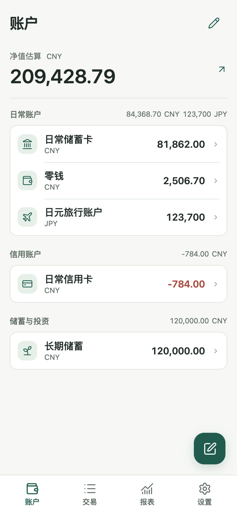
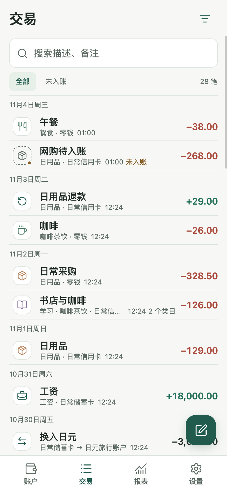
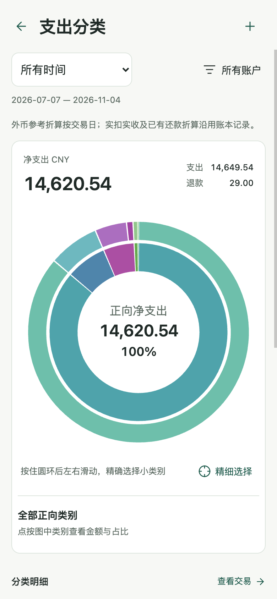

<p align="center">
  
</p>

<h1 align="center">厘序 · fine-ledger</h1>

<p align="center">离线优先的个人记账 PWA，支持多币种和自托管同步。</p>

厘序用来记录日常收支、管理多币种账户，也适合追踪旅行或项目开销。记账时先保存到设备，无网络时也能继续使用。需要在多台设备上使用同一本账时，可以自行部署同步服务。

## 截图

<table>
  <tr>
    <th>账户与净值</th>
    <th>交易流水</th>
    <th>支出分类</th>
  </tr>
  <tr>
    <td></td>
    <td></td>
    <td></td>
  </tr>
</table>

截图使用合成示例账本。

## 主要功能

- **日常记账** · 记录收支、转账与退款，支持类目拆分、项目归集和组合筛选。
- **多币种账户** · 管理现金、储蓄卡和信用卡。外币消费可先保存原币金额，等银行入账后再补录实际扣款。
- **报表** · 查看收支趋势、分类占比、项目支出、账户余额和净值走势，可从图表下钻到明细。
- **离线与备份** · 网页安装并缓存后可离线启动，账本保存在设备上，支持完整备份导出与恢复。
- **自托管同步** · 用 Docker Compose 部署自己的账本服务，在多个设备间同步。本机保存和远端同步分别显示状态。

## 快速开始

安装 Node.js 24.13.0 或更新版本，在仓库目录执行：

```sh
npm ci
npm start
```

打开 [http://127.0.0.1:4180/](http://127.0.0.1:4180/)，选择「新建账本」。这个入口运行本机版，可直接使用浏览器记账。

## 部署同步服务

仓库提供 Dockerfile 和 Docker Compose 配置，服务使用 Fastify 和 SQLite。部署时需配置持久化目录、访问密码，以及由网页和 API 共用的 HTTPS 地址。用 iPhone 的 Safari 打开部署地址，再通过分享菜单添加到主屏幕。

- [自托管部署指南](docs/server-deployment.md)
- [QNAP Container Station 部署示例](deploy/qnap/README.md)

## 项目文档

- [产品设计](docs/product-design.md)
- [技术设计](docs/technical-design.md)
- [开发与验证](docs/development.md)
- [实施计划与验收进度](docs/implementation-plan.md)
