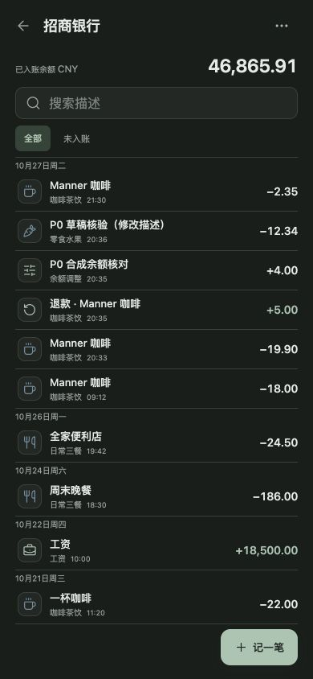

# 0.4.1 反馈处理与后续交互建议

日期：2026-10-29。依据本轮真机反馈。本轮只连接本机浏览器，未连接或操作 iPhone。

本页区分已经实施的小修和待讨论的方案；后者还没有作为新交互发布。产品设计 0.8 的金额、入账、退款、拆分与净值口径继续有效。

## 已实施的小修

| 反馈 | 原因与本次处理 |
| --- | --- |
| 支出都是标签图标 | 旧版父类使用 cup/train 等名称，子类缺少 icon；0.4.0 没有完整映射。补齐父子类映射，并一次性修复已有兼容账本；已手动编辑的类目图标保留。原始数据和修复前副本保留，金额与交易不变 |
| 账户流水过疏 | 描述、类目、时间原来分为三行，余额和日期区也偏高。改为两行，压缩余额与日期区；手机交易行实测 49 CSS px，图标的入账点击区域仍为 48px 高 |
| 空分组不能删除 | 管理 → 分组菜单 → 删除分组。只允许真正没有账户的组，含归档账户的组仍需先移出账户，避免遗失归属；删除不操作交易 |
| 不需要示例账本功能 | 移除首次使用和设置中的入口，应用固定打开个人账本。既有个人数据不清除；隔离合成夹具只保留给开发测试，不作为产品功能 |

验证：类型检查、构建和 24 项测试通过。新增测试覆盖旧图标修复、保留用户图标选择、修复幂等与副本、空分组删除和归档账户保护。本机 390×844 浏览器中，旧合成账户的 10 条交易均完整位于记账按钮上方；不同设备、安全区和日期分布会影响可见条数，未声称已在 iPhone 上复验。320px 窄屏另行检查。

## 导航与返回：统一为应用页面栈（交互 3、4、9、10）

### 已定位的原因

当前实现混用了浏览器历史和自己的触摸返回。每次主入口切换都 pushState，产生重复根页面；popstate 使用系统确认，触摸返回又使用网页确认；部分设置使用弹窗展示，却未把弹窗层级加入返回链。这些路径没有一个共同的导航状态，因此会出现两次确认、视觉上已离开但应用状态未离开、取消后无法复原，以及设置子页越过设置回到账户页。

### 建议的产品规则

1. 账户、交易、报表、设置分别作为四个根页面，各自保留独立页面栈、滚动位置与筛选。切换 Tab 不增加相互之间的返回层；再次点击当前 Tab 可回该入口的根页。根页的返回手势不切换到别的 Tab，也不制造第二个首页。
2. 返回始终处理最上层：先关闭类目选择器等临时层，再关闭当前编辑/详情页，再回到来源页。设置 → 类目管理 → 返回必须回设置；打开设置弹窗后返回只关闭该弹窗。
3. 为避免“左滑”方向歧义，统一称：从左侧边缘向右滑是返回；从右侧边缘向左滑是前进。前进仅重访当前 Tab 中刚返回过的页面，没有可前进页面就不移动。返回后打开新页面会舍弃旧的前进分支。
4. 手势拖动时只预览位移，不卸载当前页、不提前提交导航。短滑直接回弹；达到退出阈值且有修改时，编辑页先回弹，保留输入，再显示一次应用内确认：“继续填写 / 放弃修改”。取消不改变栈或输入；放弃才真正退出。按钮、手势与可兼容的浏览器返回共用同一个离开请求，确认期间不重复受理。
5. 放弃的未保存内容不通过前进手势恢复成草稿。再次进入编辑读取已保存版本；重新打开新建页是新的录入。正在选择类目只是临时离开输入焦点，不属于放弃交易。
6. 横向候选条、图表与排序手柄有明确手势范围；页面中部的水平操作不触发页面返回。

示例：`设置根页 → 类目管理 → 编辑类目`。返回两次依次回类目管理和设置根页；第三次返回不动。之后前进可依次进入刚返回的浏览页面；被放弃的未保存编辑内容不恢复。账户首页进入净值详情时，返回仍回触发它的账户首页。

### PWA 与 Safari 的边界

应用内栈、位移预览、回弹和离开确认由前端实现。Safari 外壳的原生网页手势不完全由网页支配；不能把取消 popstate 或一条 CSS 当作完整解决方案。现代 Navigation API 也只允许取消/拦截部分导航，须按实际能力检测。建议减少内部浏览器历史记录，由单一导航层管理应用页面，再做 Safari 兼容适配；后续分别验收主屏幕 PWA 和 Safari，不提前承诺二者每个原生动画都相同。

依据：[WHATWG 导航规范](https://html.spec.whatwg.org/multipage/nav-history-apis.html#the-navigate-event)、[WebKit 对 overscroll 与历史导航的记录](https://bugs.webkit.org/show_bug.cgi?id=240183)。WebKit 该记录主要涉及桌面手势，不能代替目标 iPhone 的实验结论。

### 必须验证的路径

- 四个 Tab 来回切换不累积重复首页；所有根页返回到边界即停止。
- 设置中的完整页面、编辑弹层、类目选择器逐层返回来源页。
- 新建与编辑交易分别测试短滑、取消、放弃、连续快滑；始终最多一次确认。
- 取消时所有字段、秒值、拆分项和滚动位置仍在；放弃不修改已保存交易。
- 返回/前进、创建新分支、跨入口快捷打开详情、页面恢复与离线更新不破坏栈。

## 账户整理与记账入口（交互 2、5）

跨组拖拽的需求已明确，建议扩展现有拖动：账户可落入任意组，组头与空组也可接收；悬停高亮目标组并展开折叠组，组内显示插入位置，靠近边缘自动滚动，松手后一次保存分组与顺序；取消恢复原位置。不会改变账户 ID、交易或净值标志。菜单移组只作键盘等替代操作，不再是跨组移动的必经路径。

首页入口建议收敛为：正常首页右上角只留“管理”，浮动按钮保留“记一笔”（使用记账图标）；进入管理后，标题右侧为“完成”，工具区分别提供“新增账户”“新增分组”文字按钮。两类低频创建都归到账户管理，避免两个不同含义的加号同时出现。无账户时直接给新增账户入口，不把新用户藏进空管理页。

## 交易搜索与筛选（交互 6）

产品设计 0.8 已列出组合筛选，当前前端只落实到账户，需要补齐。建议搜索常驻，匹配描述和备注；一个筛选面板承载以下条件，已生效条件以可移除的小标签展示。

| 条件 | 建议行为 |
| --- | --- |
| 时间 | 本月、上月、近 30 天、自定义区间；按账本时区 |
| 账户 | 按组多选，账户内进入时预选当前账户；可包含归档账户 |
| 类型 | 支出、收入、转账、退款、余额调整 |
| 类目 | 两层多选，父类包含子类；拆分交易只统计匹配部分，打开仍看到整笔 |
| 项目 | 多选，并提供“无项目” |
| 状态 | 全部、已入账、未入账；交易检索与正式报表口径分开 |
| 金额 | 面板底部的币种与上下限；账户内自动固定该账户币种，全账本不能混合原币金额直接比较 |

同一条件中的多个值取“或”，不同条件之间取“且”。面板内可先改条件，点击“查看 N 笔”后应用，也可清空；返回列表/详情保留条件与位置。此次另外询问了用户的高频筛选组合，后续据此调整条件排序，不自行缩减原设计功能。

## 报表首页与详情分开（交互 7）

原设计已有“报表首页 → 基础报表/常用报表 → 报表详情”，当前实现压成两个标签，应该补齐原有层级。

建议根页用紧凑的报表目录：上方“常用报表”列出用户保存的配置，下方“报表类型”列出净值走势、支出分类。以后收入结构、收支趋势、项目分析等类型按行扩展，当前不展示尚未实现的条目。

点击某一行进入独立报表详情，顶部是报表名称与返回，时间/筛选和图表属于该报表，提供“保存为常用报表”。常用报表固定记录类型、对象范围和相对/固定时间规则；管理支持更名、排序和删除配置。返回下钻恢复原图表选择。这样增加类型不会增加顶端标签，保存的配置也不会与报表类型混在一起。

## 类目管理采用常显手柄（交互 8）

建议采用用户最后提出的简化方式：管理页始终显示拖动手柄，点击名称/图标进入编辑，右侧放归档按钮，移除三个点和上移/下移。父类的展开箭头单独负责展开；拖动父类带着子类整体移动，子类可在父类之间移动，层级上限保持两层，收入/支出间不直接拖动改义。

本轮先不采用行内左右滑归档：同页要支持页面前进/返回，常显归档按钮更直接，也减少方向手势冲突。归档父类时说明会包含子类；历史引用保留，已归档类目从二级入口查看和恢复。非拖动设备仍提供可访问的移动方式。

## 建议的推进顺序

先完成统一页面栈及未保存保护，再接跨组拖动和类目整理，随后补齐筛选与报表目录。以上方案讨论完成前，0.4.1 仅包含开头列出的四项小修；导航、跨组拖动、入口收敛、组合筛选、报表目录和类目拖动均未在本轮伪装为已完成。
