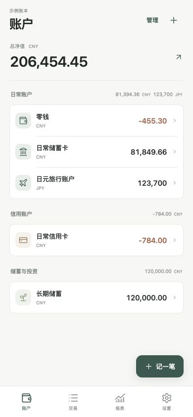
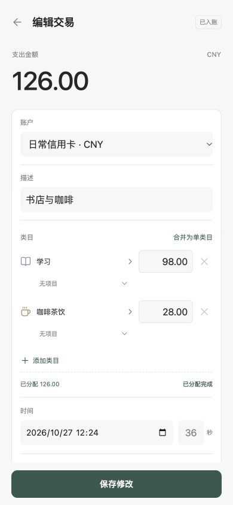
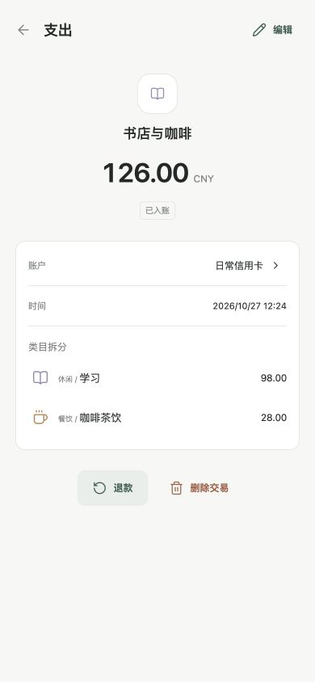
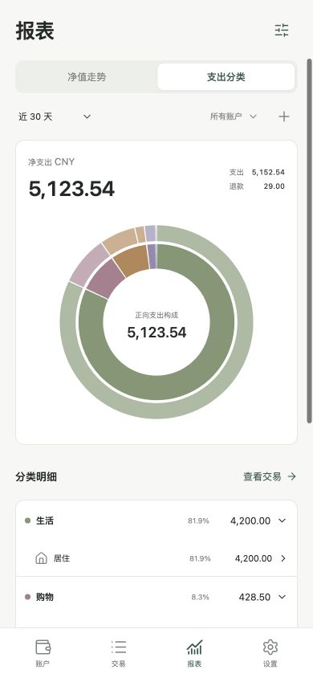

# 厘序 0.4.0 前端评审

日期：2026-10-29。依据产品设计 0.8、线框 v2 和 MoneyWiz 3 实机调研。用户本轮授权开始业务前端；之前的暂停结束。本次交付是可实际保存的本地产品前端，P0–P6 的部署、同步、迁移和数据完整性门槛仍分别保留。

## 访问

继续使用 `https://zhangkaidemac-mini.local:8445/` 或原主屏幕图标。证书、端口、路径不变，无额外查询参数。iPhone 已安装的厘序实际加载了新账户首页与记账表单，未清除其账本或重装。

## 页面与交互

| 页面 | 实现内容 |
| --- | --- |
| 账户 | 紧凑分组原币余额、一行总净值；新增中选择账户/分组；管理中只有完成；跟手排序及取消、键盘/菜单排序、移组、归档；归档交易仍可编辑，新增需取消归档 |
| 记账 | 账户上下文、支出/收入/转账；最近 8 个去重描述、包含匹配且前缀优先、类目继承；两级类目；多行金额拆分及合计校验；低频字段折叠；日期分钟选择器与独立秒输入；保存事务失败保留输入 |
| 交易 | 图标切换入账，默认入账；详情与编辑；从消费发起退款；原消费/退款可独立删除；关联退款删除时给选择；最近删除可恢复；调整余额仅在账户菜单 |
| 报表 | 净值曲线选点、时点账户与交易；内环大类/外环子类；负净退款单列；主币汇总、原币余额乘区间汇率、缺失来源明确列出；筛选时间/账户/类目，下钻保留条件并显示匹配部分和全额，返回保留报表状态；保存相对/固定日期报表 |
| 设置 | 名称、主币锁定、固定业务时区、类目和图标/颜色/层级/顺序/归档、项目、外观、归档入口、备份导出、独立示例账本及真实同步服务状态 |

同币转账校验两端相等；异币手填实际两端金额并显示推导汇率。只统计已入账。已归档账户默认仍参与总净值；临时报表范围不改账户的全局开关。源秒和小数秒在无关编辑中保留，列表只展示到分钟。账本时区初始取设备值并保存，旅行或更换设备不会自动修改；夏令时重复/不存在的手填时刻会提示选择明确时间。

## 视觉

纸白背景、松绿操作色、石墨正文、语义负值颜色；本地 Lucide 图标、原生中文字体和等宽数字。四个主入口用于手机，桌面使用侧栏与受控内容宽度。浅色/深色/系统可选，不展示 NAS、数据库就绪、P0 原型等技术标签。

实际界面截图均来自隔离示例账本：

| 账户首页 | 记账与拆分 |
| --- | --- |
|  |  |

| 交易详情 | 分类报表 |
| --- | --- |
|  |  |

[净值曲线截图](evidence/frontend-v0.4.0/net-worth.png)。截图用于说明交付界面，合成金额不是用户真实资产。

## 工程与验证

- React、TypeScript、Vite、Dexie、dnd-kit 与 Lucide，依赖精确版本进入锁文件。Temporal 兼容实现用于账本时区、夏令时和日界线。
- 金额为整数最小单位字符串，运算用 BigInt；转换以有理数计算，仅最后显示/记账时舍入。SVG 中浮点数只用于画图。
- 本机保存与前后变更、操作日志在同一 IndexedDB 事务中提交；日志失败会整体回滚。修订记录实体差异，避免每保存一次复制整本历史账目。
- 原个人数据库原位升级；旧数据原件保留在 `legacy-book-v2`，旧 outbox/草稿不清除；示例独立。此兼容路径只针对旧 P0，不能替代 MoneyWiz 正式导入。
- `npm run check`、`npm test`、`npm run build` 通过；21 项测试覆盖金额大数与精度、拆分、入账、归档、退款、区间/间接汇率、缺失来源、微秒及夏令时、升级、事务回滚、更新/离线应用壳与发布一致性。
- 浏览器实际完成拆分新增、编辑、删除、排序、刷新保留、浅深主题、报表下钻匹配部分、90 天报表返回保留。320 px/390 px 无横向溢出；桌面与深色已检查。
- 停止本次启动的 4180 静态服务后，浏览器通过缓存重载，新增并保存 12.34 的合成记录，再次重载可查询到；未停止 8445 或改变系统网络。
- 原 CA 严格校验 8445 TLS，根入口 `no-store`，入口和全部资源对应同一内容指纹版本，URL 无参数。
- iPhone 镜像确认原安装加载新版、表单候选和秒输入、左边缘返回；没有在手机的现有个人账本写入测试交易。镜像使用硬件输入，完整软键盘、中文组合输入、飞行模式冷启动与强退恢复仍需目标设备复验。

## 本轮边界

云端密码认证、设备会话和真实同步由 P2 交付，页面如实显示未连接。完整银行最终入账分摊、对账、全量 MoneyWiz 试导入、导出回导、NAS 与两设备恢复尚未验收。这里的本地汇率与报表合成计算不表示十年真实数据的成本闭环已经通过。分期计划与预算继续后置。

可以先在设置中进入独立示例账本 review 账户、拆分、退款和报表；本轮不执行真实账本切换。
