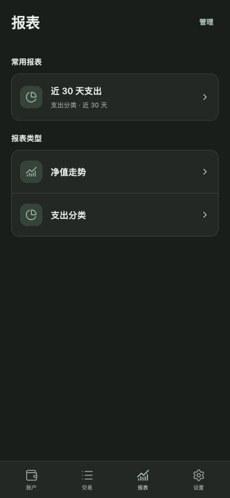
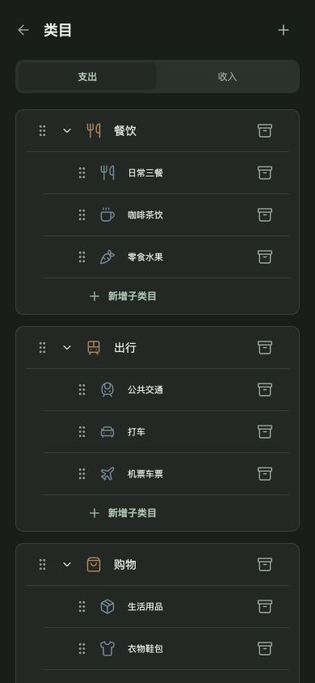
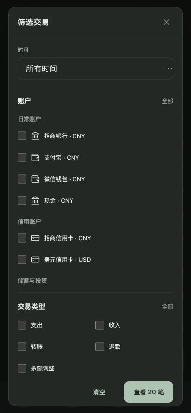

# 0.5.0 页面栈与管理流程交付

日期：2026-10-29。用户已授权按上一轮建议继续实现；原地址 `https://zhangkaidemac-mini.local:8445/`、路径 `/`、端口与原证书保持不变，无附加参数。未连接或操作 iPhone。

发布标识：`0.5.0-7036d679aa46657b`。通过原局域网服务连接，按原域名与 CA 校验 TLS；首页、Service Worker、release.json 与 7 个资源共 10 项全部返回 200，内容与发布文件逐字节一致。

## 本次范围

- 四个主入口维护独立页面栈，主入口切换不累积主页。返回先关闭最上层弹窗/选择器；设置 → 类目 → 编辑可逐层退出。根页停止返回；前进仅重访当前分支，打开新页面清除旧前进分支。
- 左边缘向右拖动返回，右边缘向左拖动前进。页面跟随拖动，短滑回弹；未保存时回弹后显示一次网页确认。按钮、手势与浏览器返回共享离开流程，不再同时出现系统确认。取消保留金额、描述、秒值等状态；放弃后前进不会恢复废弃内容。
- 账户可跨组拖动，组头与空组能接收；显示目标组和插入标记、拖动浮层与自动滚动。落下后一次保存分组与顺序，取消不写入。普通首页保留管理与记一笔，管理工具区提供新增账户和新增分组。
- 类目手柄常显，点击名称/图标编辑，右侧归档/恢复。父类移动带着子类，子类可跨父类拖动；同收支类型、最多两层。编辑保留所属父类选择，供非拖动方式使用；键盘也可操作排序手柄。
- 组合筛选：时间、分组账户多选、交易类型、父子类目、项目/无项目、入账状态、按币种金额上下限。搜索描述、备注和拆分备注；面板预览笔数，应用后显示可移除标签。详情返回保留搜索、条件、已加载数量和位置。正式报表下钻的已入账范围继续保留。
- 报表首页改为目录，常用报表与类型分开；独立净值/分类详情保留时间、范围与图表状态。常用配置可保存、更名、拖动排序及删除，不影响交易。
- 启动和恢复前台时主动检查更新，并检查当前控制器版本；未保存编辑或弹层未结束时推迟版本切换。本次不改账本格式，不清理 IndexedDB 或缓存来强制更新。

## 验证

类型检查、构建与 31 项自动化测试通过。新增覆盖独立页面栈、根边界、前进分支、报表来源返回、跨组移动、归档账户/历史引用保护、类目层级限制、组合条件与拆分交集、账本时区及跨币种转账匹配端点。既有金额、历史汇率、时区精度、迁移、原子保存、离线壳升级测试继续通过。

本机浏览器 390×844 实际操作验证：

- 设置 → 类目 → 编辑，浏览器返回只出现一次应用确认；继续填写保留原输入，放弃不保存；再次返回回到设置，根页再返回不动，前进回类目。
- 记账页填写金额、描述、秒值；边缘拖动返回出现一次确认，继续填写字段保留；短滑不退出；放弃后右边缘前进重新打开空表单。选择类目时浏览器返回只关闭选择器，保留录入。
- 账户拖进另一分组后归属与组余额更新，净值不变；子类目拖到另一个父类成功。两项验证均在本机既有合成数据上进行，随后恢复原归属/顺序，未操作手机账本。
- 支出 + 已入账 + CNY 10–300 的条件组合实时预览并应用，返回详情仍保留条件。
- 分类报表以双层环图展示，保存后进入常用报表目录；更名入口、管理手柄和配置删除入口可访问。

另在 320px 窄屏检查组合筛选，弹窗宽 286px、内容滚动宽 284px，无横向溢出。

截图来自本机浏览器，用于检查布局与操作结果，不代表 iPhone 真机验收。

## 验收边界

Safari 自身的历史手势不是网页能够完全保证的动画。前端用同地址的固定历史保护槽桥接浏览器操作，内部路由不再不断写入浏览器历史；边缘区域处理应用手势，并抑制同一手势重复触发。仍需分别在主屏幕 PWA 与 iPhone Safari 验证手势、键盘和安全区，本轮遵守此前不连接 iPhone 的要求。

本版不宣称同步服务、全量迁移、银行成本/对账或首版全面验收已完成。继承已确认的入账、拆分、退款、区间汇率和净值规则。
