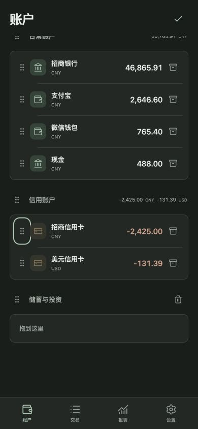
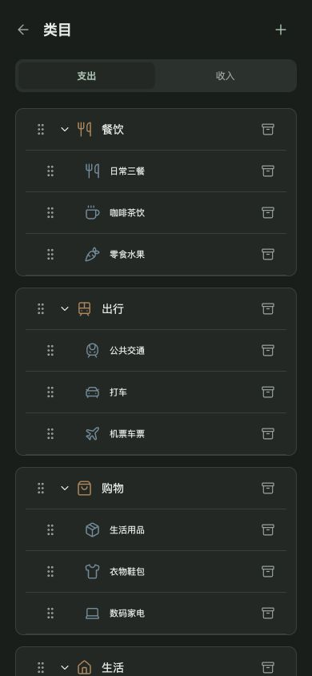
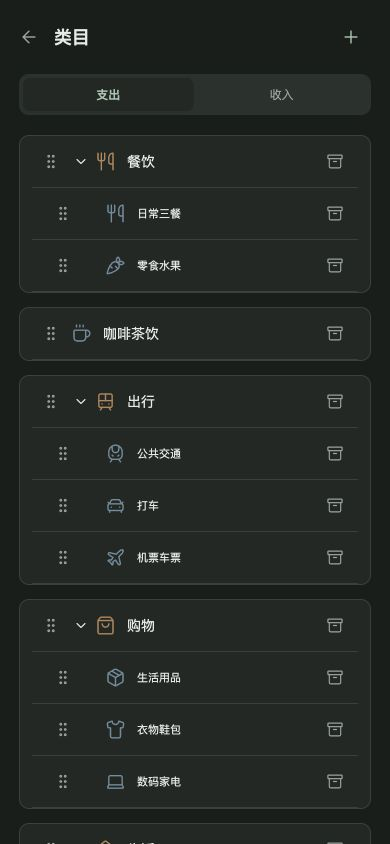

# 0.6.0 导航预览与拖拽整理修复

依据用户本轮八项反馈及两张 iPhone 截图。访问仍为 `https://zhangkaidemac-mini.local:8445/`，无新参数；原证书、缓存和账本保留。发布标识 `0.6.0-6d9cc2094cbbaa8f`；原 CA 校验通过，11 项发布资源内容均与磁盘版本一致。

## 反馈处理

| 项目 | 本版处理 |
| --- | --- |
| 滑动露出启动提示页 | 旧实现建立了同地址的多个浏览器历史保护槽，截图与这些历史页面的启动快照一致。本版停止创建保护槽；应用自己绘制目标页面，直接用当前账本和保存的滚动位置作只读预览 |
| 根页仍能划开 | 原生 touchstart 在边缘使用非 passive 捕获并取消默认历史手势；四个根页没有后退目标时不产生位移。应用页面栈继续独立保存，短滑回弹 |
| 松手回到旧位置 | 排序在渲染层先同步提交目标布局，DragOverlay 再测量落点；持久化失败撤销预览并提示。账户/分组/类目共用这条流程 |
| 招商信用卡被当成分组 | 旧演示数据中账户和分组都使用 ID `credit`。拖拽标识改为 `account:credit`、`group:credit`；数据库 ID 和历史引用不改。行排序与组头/空组投放目标分别匹配，组内显示插入线，不再把整组当成唯一落点 |
| 账户和类目管理不统一 | 两者均为点击条目编辑，右侧直接归档/恢复，左侧手柄负责拖动；账户的三个点、上移/下移/菜单移组入口移除。空分组在管理时可直接删除，仍保护含归档账户的组 |
| 归档与缩进过重、不能单层 | 归档图标 17px，点击区 36px，透明无底框；压紧子类缩进。类目可无上级，独立项直接选择，不强迫打开第二列；有子类时按需展开。账户分组可选“不分组”，普通首页直接展示未分组账户，管理时保留明确投放区。新建账本不自动添加空分组 |
| 管理、记账入口样式不统一 | 首页管理改为列表整理图标，完成为勾；账户与交易列表的记账改为同风格的记账图标，保留可访问名称与桌面提示 |
| 长按触发文字选择 | 仅手柄禁止选择及系统长按菜单；触屏长按 280ms 才激活，容差 7px，提前移动不启动拖拽。实际拖动期间临时禁止选择，结束/取消后恢复。名称文字显式允许选择，选择后点击不进入编辑；鼠标维持常规按住移动，键盘手柄仍保留 |

预览页为 inert/aria-hidden 的只读页面，不响应操作、不保存数据、不注册选择器、不改变未保存状态，也不自动聚焦输入框。放弃输入后再前进，预览及正式进入的新建页都是新的空表单，不从放弃内容恢复草稿。滑动达到退出阈值仍先回弹，再显示一次应用内未保存确认。

## 验证

- 类型检查、构建、38 项自动测试通过；新增覆盖边缘事件取消默认行为、页面中部及多指输入保留、监听器清理、账户/分组同名 ID 隔离、无分组账户移动、单层类目及历史引用。
- 本机 390×844 浏览器：根页拖动后 transform 为空、无下层页；记账短滑时下层实际为账户页，包含六个账户名称，没有启动提示节点；短滑回弹、取消未保存确认仍保留金额。
- 放弃金额后短滑前进，预览为金额为空的记账页，焦点仍在 BODY，没有抢出键盘。
- 招商信用卡和美元信用卡可用鼠标在本组交换，未移动信用账户分组；组内和组头投放目标分开。验收后用拖拽恢复本机合成数据顺序。
- 已有账户可编辑为不分组，仍出现在首页，净值不变；已恢复原归属。类目可编辑为独立项，在记账时直接选择，验证后恢复原上级；未保存测试交易。
- 类目手柄启动排序后，名称 user-select 为 none；Escape 取消后恢复 text，手柄仍为 none。
- 320px 窄屏中 body 与主内容宽度均为 320px，没有横向溢出。
- 本轮没有重新连接 iPhone。触屏激活时长、原生 Safari 动画拦截和真实跟手落下效果仍需目标设备复验，不把本机 DOM/键盘/鼠标验证当作真机结论。

边缘事件处理参考 [Apple 触摸事件说明](https://developer.apple.com/library/archive/documentation/AppleApplications/Reference/SafariWebContent/HandlingEvents/HandlingEvents.html) 和 [WebKit 对 iOS 原生手势拦截的记录](https://bugs.webkit.org/show_bug.cgi?id=240892)。这些资料不代替当前 iPhone 的实际验证。
