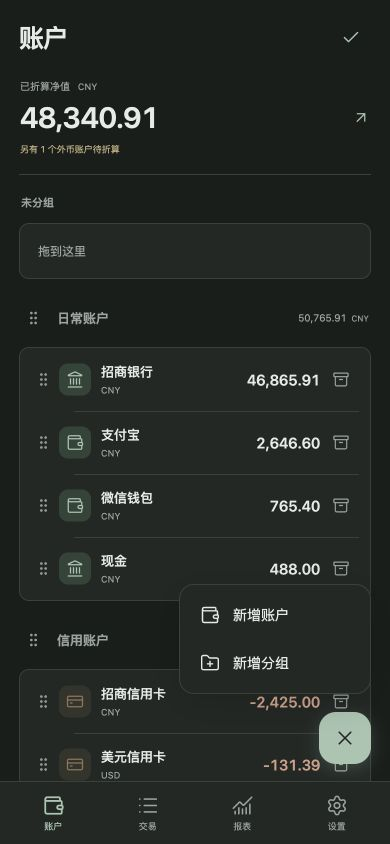
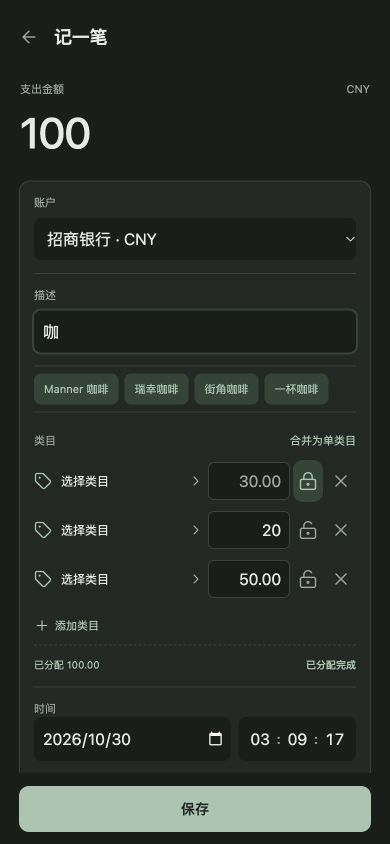

# 0.7.0 滑动、键盘录入与时区

日期：2026-10-30。依据本轮九项反馈及用户对时区的最终确认。固定入口仍为 `https://zhangkaidemac-mini.local:8445/`，不改变端口、路径、证书或增加参数。

## 交互结果

| 反馈 | 处理 |
| --- | --- |
| 根页面没有滑动反馈 | 没有后退/前进目标时，页面按非线性阻尼最多移动 26px，露出边缘阴影；松手回位，不创建空历史页 |
| 返回时先回弹再切页 | 正常成功滑动从释放位置继续移动至屏幕边缘，动画完成后才提交页面栈；短距离和取消才回弹。距离及快速短甩均可完成。未保存表单仍先回弹到原页，再出现一次应用内确认；取消保留输入，确认后滑出 |
| 管理页添加入口重复 | 管理模式只留浮动加号，展开紧邻按钮的新增账户/分组菜单。可点外部、按 Escape 或边缘返回关闭；桌面方向键可移动菜单焦点 |
| 首页显示归档链接 | 移除首页链接，归档账户统一在设置查看；其历史余额和净值仍保留 |
| 描述联想被键盘遮住 | 新建时即准备最近候选，聚焦金额或描述时可显示；描述变化即时更新候选。打开键盘时把候选条挂到 body，随 visualViewport 的大小与偏移定位，避免页面 transform 产生新的 fixed 包含块。无键盘时放在描述附近，点击候选不因 blur 先丢失焦点 |
| 秒与日期时间割裂 | 日期独立选择，时分秒为一个连续 HH:mm:ss 控件；列表仍只显示分钟，保存仍保留秒。无关编辑保留导入的小数秒 |
| 账户内筛选图标不清 | 筛选使用 ListFilter 漏斗，账户菜单使用省略号，首页管理改为 ListOrdered 整理图标 |
| 拆分要自动分摊和锁定 | 总额先减锁定值，剩余以整数最小货币单位均分；新增、删除、解锁或修改总额时重新分配。手动改一项时本次先保留它，再分给其他未锁定项；锁定值不变，超额/无可分项就地提示。项目在交易级选择，不逐行重复 |
| 时区默认跟随系统 | 存储 UTC 绝对时刻，录入/显示/日期筛选/报表使用同一个有效时区，默认跟随系统，可固定覆盖。回到前台及系统时区变化后刷新。旅行可能改变日/月归属，原时间戳不改写。已经打开的录入页固定其打开时的时区 |

项目存储暂沿用拆分关联以兼容旧账本；新录入统一填同一个交易项目。已有多项目拆分保留原关联，修改无关字段不覆盖；主动选统一项目才替换，合并类目时明确提示其项目也合并。锁定只控制当前表单分配，不改变历史金额，不要求数据库升级。

## 平台和设计依据

[Apple Pull-down buttons](https://developer.apple.com/design/human-interface-guidelines/pull-down-buttons) 明确举例：Add 按钮可用菜单指定新增对象类型。采用这一菜单模式；浮动按钮位置来自本次产品反馈，并非 Apple 规定必须使用浮动按钮。

SSH 等原生 App 可通过 UIKit 的 [inputAccessoryView](https://developer.apple.com/documentation/uikit/uiresponder/inputaccessoryview) 添加键盘附件。iPhone PWA 没有这个原生接口，不能把网页候选注入系统输入法或改动其拼音选词栏。网页候选采用 [CSSOM View 的 VisualViewport](https://www.w3.org/TR/cssom-view/#visualviewport) 观察键盘出现后的可见范围，在网页里紧贴其底边呈现一行横向候选；不是更换键盘。

WebKit 社区记录了 [软键盘下 fixed 元素的历史问题](https://bugs.webkit.org/show_bug.cgi?id=191204) 及 [键盘视口平移问题](https://bugs.webkit.org/show_bug.cgi?id=311821)。这些记录用于识别需规避的布局组合，不证明当前手机具体根因；本轮将候选条移出变换容器，真机仍需复验。

## 验证与边界

- 类型检查、构建和 42 项自动测试通过。新增覆盖精确均分、锁定与手动额、增删行、超额保护、大整数/无小数币种、根页阻尼、部分距离快速甩动，以及系统/固定时区下 UTC 输入与报表跨日边界。
- 本机浏览器 390×844：管理加号展开新增菜单，选择新增分组打开正确编辑器；Escape 关闭菜单并归还焦点。账户页没有归档入口，设置仍保留入口。
- 总额 100，锁定第一项 30，新增第三项得 30/35/35；手动把第二项改成 20，得到 30/20/50。金额不变且无差额。没有保存测试交易。
- 描述输入“咖”无需失焦便显示包含匹配候选；新建打开即有最近候选。时/分/秒可连续编辑，320px 下页面宽度仍为 320px，时间行无横向溢出。
- 本机鼠标边缘拖动到中间可完成账户详情→账户页返回；未保存表单的边缘返回只出现一次应用内确认，取消后金额 100 仍在。没有浏览器确认弹窗。
- 发布 `0.7.0-9974bcb36822a7c7`，原 8445 服务和原 CA 证书校验通过，首页、worker、版本元数据及 8 个离线资源共 11 项与磁盘发布逐字节一致。
- 本轮未连接 iPhone。桌面视口不等于 iOS 软件键盘；候选条相对真实键盘/选词栏的位置、触屏滑出惯性及原生边缘手势仍需用户用原主屏幕图标复验。没有把桌面测试作为真机通过，也没有清除本机数据或要求重装。

