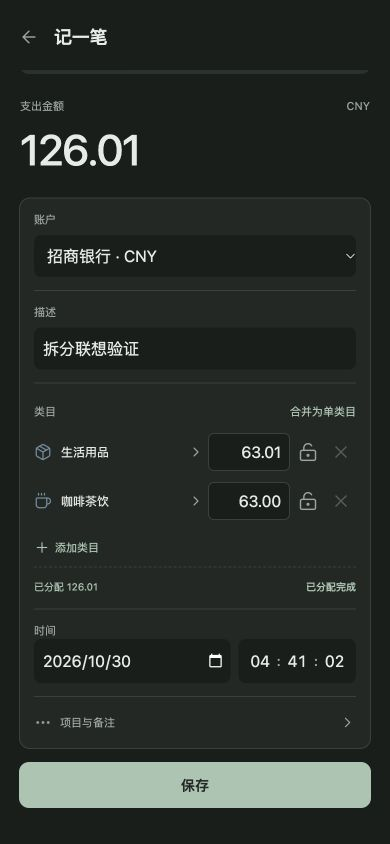
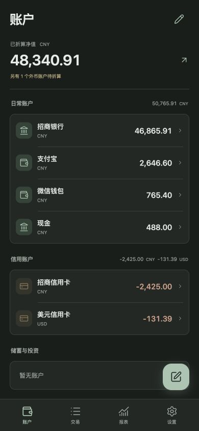

# 0.7.1 拆分联想修正与 P1 收尾

日期：2026-10-30。用户明确说明：近期反馈来自 iPhone 实机测试，本轮两项反馈按实机观察记录。本文区分用户的实机反馈、本轮本机回归验证及尚待补齐的阶段验收。

## 修正

- 原描述候选处理只读第一项，并且用 `splitMode` 阻止再次自动预填，因此多类目被截成单项。本版继承候选中的全部类目及原顺序，多项时自动展开拆分，单项时回到普通类目行。
- 当前总额均分到所有继承项，不沿用历史金额比例；金额为空时各项为 0，随后输入总额立即均分。各项默认未锁定，沿用最小货币单位的确定性尾差规则。
- 继承时生成新的拆分 ID，不带入历史项目、备注或锁定状态，不修改原交易；归档或失效类目保留待选行并提示重新选择。已手动整理的类目仍保留原有保护。
- 首页管理原图标为 Lucide `ListOrdered`（有序列表），容易被理解为自动排序；改为 `Pencil`（铅笔），表示编辑账户结构和布局，完成时显示勾号，无障碍名称仍为“管理账户”。

## 验证

- `npm run check` 和 43 项自动测试通过。新增回归检查：全部类目及顺序、当前金额均分、0 金额后再输入、单类目切换、归档类目、新 ID、不复制历史项目/备注以及原交易不变。
- 本机浏览器创建一笔合成拆分交易：生活用品、咖啡茶饮。选择其描述且未输入金额时，两项均为 0.00；输入 126.01 后得到 63.01/63.00。
- 切换到普通咖啡候选后回到单类目，再选择拆分候选重新得到两项均分。管理入口实际渲染 `lucide-pencil`。
- 本机合成样例已通过正常“删除交易”流程逻辑删除，账户余额及总净值恢复验证前数值；没有连接或修改手机账本。
- 发布 `0.7.1-c174fa5429e3aaa8`，仍使用原 `https://zhangkaidemac-mini.local:8445/`。原 CA 校验通过，首页、worker、发布元数据及 8 个资源共 11 项与磁盘发布内容一致，见[验证数据](evidence/frontend-v0.7.1/https-verification.json)。

## P1 判断

P1 主要功能开发已完成，当前是验收收尾，详见[实施计划的当前状态](implementation-plan.md)。本地流程不应继续笼统记为“仅原型”或“没有真机反馈”。用户随后确认断网新增/编辑/删除后的强退重开只验证了部分操作，具体已通过项目待明确；保留这些实机结果，只补未验证项。严格的阶段通过记录仍需补齐这组验证的剩余结果，以及注明设备、系统版本、账本规模、样本数的初步性能记录。0.5.1 已完成的两次完全离线冷启动无需重复否定，但不能替代上述写入保留验证。

NAS 同步、跨设备恢复、真实历史成本闭环及正式迁移属于后续阶段，不因为已有相应页面而记为完成。本轮不启动 P2。

