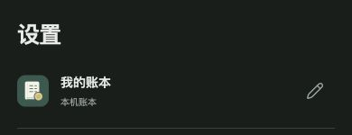

# 0.7.2 品牌图标首版

日期：2026-10-30。用户授权先给出方向建议，再按最推荐方向制作并发布，随后 review。

## 方向与选择

1. **账簿＋硬币，先采用**：记账和资产含义直接，以少量较大的形状保证小尺寸辨识度。
2. 展开的双页账本：更安静简洁，但可能与笔记、阅读应用混淆。
3. 钱包＋收支箭头：日常消费含义直接，但更接近支付或电子钱包产品。

本版使用深松绿底、纸白账簿、两列短线及暖金硬币；没有汉字、字母或固定币种符号。当前为待用户视觉 review 的首版，不表示最终品牌定稿。

采用原生 SVG 几何图形，保留可编辑源 `public/icon.svg`；PNG 用本机已有 Sharp 0.35.5 从同一 SVG 输出，没有新增运行依赖。未使用位图生成工具，适用原因是现有源为可编辑矢量，且图形需要精确缩放。图标形状直接替换旧版，不保留旧抽象字形。

## 接入

- 网页 favicon：`public/icon.svg`。
- PWA 安装素材：192/512px PNG，512px 兼顾 maskable，应用身份、manifest id、start_url、scope 不变。
- iPhone 图标：独立的 180px `apple-touch-icon-ledger-v1.png`，HTML 指定 sizes，纳入发布指纹和完整离线缓存。资源文件名变化，应用入口没有新增参数。
- 启动占位、侧栏、设置及建账页面统一使用相同图形；应用内由容器裁圆角，安装素材保持完整不透明方形画布。

简化、小尺寸和由系统裁角的原则参考 [Apple App icons](https://developer.apple.com/design/human-interface-guidelines/app-icons)。PNG 的 PWA 接入参考 [Apple Web Clip 图标配置](https://developer.apple.com/library/archive/documentation/AppleApplications/Reference/SafariWebContent/ConfiguringWebApplications/ConfiguringWebApplications.html)；这些静态素材并非原生应用的多层 Icon Composer 文件。

## 验证与发布

- 类型检查、构建、43 项现有测试通过；完整发布仍支持自动更新和离线启动。
- 192/512/180px PNG 的尺寸均正确，不含 alpha 通道；512px 图形最远半径 202.44px，位于 maskable 中央安全圆半径 204.8px 内。见[图标检查](evidence/frontend-v0.7.2/icon-verification.json)。
- 390×844 本机浏览器设置页图标成功加载，尺寸为 35×35；HTML 指向新的 180px 安装图标，版本显示 `0.7.2-9cf0441e6a565f60`，没有浏览器错误或警告。
- 原地址 `https://zhangkaidemac-mini.local:8445/` 与证书保持不变；首页、worker、发布元数据及 9 个资源共 12 项与磁盘内容一致。见[HTTPS 检查](evidence/frontend-v0.7.2/https-verification.json)。
- 线上安装素材与应用内标识已验证；本轮没有连接 iPhone，尚未验证 iOS 已安装的主屏幕图标是否刷新，不保证网站更新会立即替换系统保存的图标。没有清除数据、删除原图标或重装应用。

