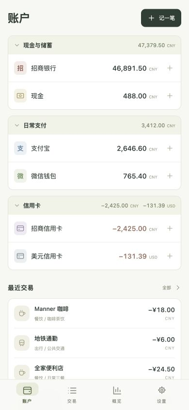

# 0.3 交互修订

日期：2026-10-27。依据本轮用户的 MoneyWiz 界面参考与六项反馈调整；截图仅作为信息密度参考，不引入截图里的账户数据。

## iPhone 打开新版

关闭旧主屏幕应用及 Safari 中该来源的页面，再用 Safari 打开：

**<https://zhangkaidemac-mini.local:8445/?v=0.3.0>**

若出现“有新版本可用”，点击“更新”。随后重新打开原主屏幕图标即可，不必删除或重装。参数 v 不改变 origin，原账本和草稿继续保留。原本固定使用 IP 来源的设备请仍用 <https://192.168.0.241:8445/?v=0.3.0>，不要切换来源。

## 六项变化

- 首页改为现金与储蓄、日常支付、信用卡三个紧凑分组，显示各账户余额与分组原币合计。可折叠分组；390 × 844 尺寸下 6 个示例账户可在首屏完整显示。
- 去掉大块净余额/月度摘要、弱信息抬头和隐藏金额功能。收支仍在“概览”查看。
- 移除常驻教学说明、冗长提示、小字图例。业务必要的币种、时间、错误反馈保留。
- 日常页面和设置没有 P0/原型阶段标记；版本、示例数据来源和未连接 NAS 状态收在主动开启的开发者信息内。后端范围没有因此变成完整正式账本。
- 描述候选改为横向条，聚焦描述时停靠表单底部，通过可视区域变化贴近软键盘上缘。候选条是页面控件，不是系统输入法候选栏。支持原来的 8 项历史、子串匹配、前缀优先与选后带入类目。
- 交易详情增加“删除记录”；删除后可立即撤销，或从设置 → 最近删除恢复。余额、报表与候选历史同步反映删除结果。关联退款的消费需先处理退款记录，避免断链。

[描述候选条](review/v0.3-entry-candidates.png) · [可视区域缩小模拟](review/v0.3-entry-occluded.png)

## 验证与边界

自动化 16/16 通过，覆盖原有金额、匹配、退款规则，以及分组原币合计、各种交易删除与恢复、退款依赖、恢复时超额校验、候选与余额排除墓碑、重复删除幂等。

真实桌面浏览器走通保存 → 删除 → 撤销、删除后重载 → 最近删除恢复，以及有关联退款的消费拒绝删除，提示在详情弹层内直接可见。删除记录与操作意图在一个本地事务内提交；完整导出保留墓碑与修订，不物理擦除。

旧浏览器账本已升级至 IndexedDB 物理版本 2，升级前的账户余额、记录与草稿保留。物理版本升级阻止不认识删除标记的旧客户端继续写入；业务账本导出 schema 仍为 1。

布局验证使用桌面浏览器的 390 × 844 手机尺寸及 390 × 470 可视区域缩小模拟。在缩小区域中，描述输入位于内容可见区，保存按钮底部在 424 px，候选条底部在 470 px，无横向溢出。该模拟没有真实 iOS 键盘工具条、拼音候选或主屏幕安全区域，不能替代本轮 iPhone 复验。

HTTPS 与完整应用壳资源核验见 [0.3 验证结果](review/v0.3-verification.json)。原 8445 证书、服务和账本来源沿用，不生成新证书，不读取或修改手机账本。

实现依据：[VisualViewport](https://developer.mozilla.org/en-US/docs/Web/API/VisualViewport) 可感知屏幕键盘导致的可视区域变化；[WebKit 安全区域说明](https://webkit.org/blog/7929/designing-websites-for-iphone-x/) 用于刘海和底部安全区布局。最终键盘上缘的实际贴合程度仍需用户在目标 iPhone 上确认。
