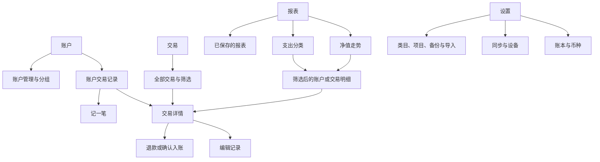

# 厘序产品设计

版本：0.1
日期：2026-10-28
状态：产品设计草案，供讨论；尚未冻结，也不代表对应功能已经实现。
范围：面向使用者的信息架构、页面职责、导航、录入与管理、同步配置、多币种和报表体验。

配套文档：[业务需求与规则](requirements.md)、[技术设计](technical-design.md)、[实施计划](implementation-plan.md)。本文件回答“用户从哪里进入、看到什么、如何完成任务、如何理解结果”。金额、退款、还款与对账仍遵守业务规则；存储和接口由技术设计承接。

## 1. 产品定位与本轮设计边界

### 1.1 要解决的问题

厘序是一款本地优先的个人记账应用。用户可以快速记录日常收支，管理不同账户和币种，按自己关心的账户、支出类别和时间查看报表，并选择是否连接自己的同步服务。

设计面向可以分享给朋友使用的通用产品：账户名称、账户分组、收支类目、主币种、时区和同步服务都可配置。正式使用时从空账本开始，不自动放入个人银行账户、固定卡号、演示余额或示例交易。示例环境与真实账本隔离。

首版使用者仍是“单人、多设备”。分享软件意味着朋友可以建立各自的独立账本；多人共同编辑一本账、家庭成员权限、厂商托管云服务不自动进入首版范围。自托管服务可以部署在 NAS 或其他用户控制的服务器上。

### 1.2 已明确的要求

| 主题 | 本轮确定的方向 |
| --- | --- |
| 首页 | 优先展示按组排列的账户及余额，提高首屏信息密度 |
| 记账 | 保持账户上下文，方便连续录入；描述补全带入最近类目 |
| 低频字段 | 项目、备注等按需展开，不挤占日常录入 |
| 导航 | 支持左侧边缘返回；返回按钮可保持小图标，但要容易点中 |
| 交易管理 | 支持编辑、删除、撤销与恢复，不能只提供新增 |
| 账户管理 | 支持新增账户、排序和设置账户分组 |
| 跨币种转账 | 正式能力必须覆盖跨币种转账和还款，可以后续实现 |
| 同步 | 是可配置的独立功能；面向用户的名称和流程不绑定 NAS |
| 币种 | 账本选择主币种，账户设置独立币种，报表折算到主币种 |
| 报表 | 优先设计净值走势和支出分类；支持对象选择与时间范围 |
| 产品呈现 | 页面按长期使用的正式产品设计，不显示 P0/原型标签或常驻教学说明 |
| 发布 | 继续使用固定安装与访问地址，用户不需要更换端口、添加参数或清数据来获取更新 |

### 1.3 本稿提出的默认方案

以下为设计建议，尚不是用户已经确认的决定：

- 首版每个安装环境激活一本账本，优先把一本账的使用和恢复做完整。
- 主币种在创建或迁移账本时选择，默认人民币；有正式记录后，首版暂不直接更换主币种。以后以独立的变更预览和迁移流程支持。
- 同步采用自托管服务，首版推荐“服务地址 + 访问口令”连接，随后保持设备会话。一次性设备配对码作为后续简化方式。
- 同源部署是首版交付方式。连接另一个来源的服务时，从目标服务的 PWA 入口进入并完成账本迁移；统一前端任意连接跨域服务不在首版承诺内。
- 报表优先交付净值曲线、分类条形图、完整筛选与下钻，再增加更多图表形式。

## 2. 用户任务与产品原则

| 任务 | 用户希望获得的结果 |
| --- | --- |
| 快速记一笔 | 在常用账户里输入金额和描述，类目尽量自动带出，保存后立即结束或继续 |
| 修正一笔记录 | 找到原记录直接修改，知道相关余额、退款或对账会受到什么影响 |
| 整理账户 | 把常用账户放前面，按自己的习惯分组，不破坏旧交易 |
| 查看财务变化 | 选择账户和时间，看到可解释、可下钻的净值走势 |
| 查看钱花在哪里 | 选择支出类别和时间，查看总支出、退款、净支出及原始明细 |
| 跨设备使用 | 明确连接哪一个服务、哪一本账；设备不可达时仍可记账 |
| 在新设备继续 | 连接既有账本，先核对账本身份和余额，再恢复本机使用 |

原则：高频任务短路径，低频任务有明确归属；尽量通过默认值和历史输入减少操作。首页显示业务信息，开发者信息放到专门入口。错误在发生处反馈，保存成功只表示已真正保存。所有汇总都能解释来源，缺少汇率或存在冲突时给出具体缺口。

## 3. 用户理解的几个概念

| 概念 | 产品中的含义 | 例子 |
| --- | --- | --- |
| 账本 | 一套独立的账户、交易、类目、主币种和报表偏好 | “个人账本” |
| 账户 | 一种币种下的钱或负债 | 人民币储蓄卡、美元信用卡 |
| 账户类型 | 决定业务行为，例如信用卡负债和还款 | 现金、银行、电子钱包、信用卡 |
| 账户分组 | 仅用于整理账户首页，可自行命名和排序 | 日常、储蓄、信用卡、不常用 |
| 收支类目 | 表示一笔收入或支出的用途，可分层 | 餐饮 → 咖啡茶饮 |
| 旅游项目 | 汇集一次旅行中跨类目的费用 | “京都旅行” |
| 主币种 | 本账本报表和成本确认使用的基准币种 | CNY；也可在建账时选其他已支持币种 |
| 同步服务 | 保存跨设备账本副本的服务 | 用户自行部署的服务 |

账户分组可以跨账户类型。把信用卡移到“日常”组，不会把它变成储蓄账户。将消费从“餐饮”改为“购物”，也不会改变它属于哪个账户组。

## 4. 信息架构与页面职责

手机保留四个主入口：**账户、交易、报表、设置**。桌面采用同样的概念，使用侧栏、列表与详情并排提高操作效率。



| 页面 | 主要内容 | 主要操作 |
| --- | --- | --- |
| 账户首页 | 分组、账户名称、原币余额 | 进入账户、快速新增、管理账户 |
| 账户交易记录 | 当前余额、按日分组的交易、搜索筛选 | 记一笔、打开详情、账户菜单 |
| 全部交易 | 跨账户交易与组合筛选 | 搜索、筛选、打开详情 |
| 交易详情 | 金额、账户、日期、类目、项目、关联业务 | 编辑、退款、确认入账、删除 |
| 记一笔/编辑 | 高频字段、候选条、折叠选填字段 | 保存、保存后继续、收起草稿 |
| 报表首页 | 两种基础报表入口、常用报表 | 打开、创建、整理已保存报表 |
| 报表详情 | 图表、汇总、筛选、下钻 | 改范围、查看明细、保存配置 |
| 设置 | 账本、币种、同步、管理与数据操作 | 更改配置、导出、恢复 |

首页不再放占据大块空间的净值与月收支摘要。净值属于报表，账户首页优先完成账户选择。

## 5. 首次使用与账本设置

### 5.1 新建本机账本

首次进入提供“新建账本”和“连接已有账本”两个入口。

新建流程：填写账本名称 → 选择主币种和业务时区 → 添加第一个账户 → 进入该账户。主币种默认 CNY，时区默认取设备当前时区供确认；默认值仍可修改。更换设备或旅行时不自动改变账本时区和历史业务日期。默认收支类目可使用一套简洁模板，之后可以更名、归档和重新排序。

同步是可跳过的独立步骤。用户可以先完成记账，再到设置启用同步。未启用同步是正常使用模式，不显示连接失败或大量“待同步”告警。

空账户页只提供“添加账户”主操作；空交易页提供“记一笔”。说明按首次需要出现，不在长期使用中重复占据空间。

### 5.2 连接已有账本

输入或确认服务地址 → 输入访问口令 → 展示远端账本预览 → 确认连接 → 准备本机副本 → 进入账户。

预览至少显示账本名称、主币种、账户数量、最近更新时间和若干账户余额，帮助用户确认连接对象。首次准备完成前清楚显示进度；完成后才提示可离线使用。

本机已有其他账本时进入专门的切换流程，不能用远端内容直接覆盖当前数据，见第 9 节。

## 6. 导航、返回与手势

### 6.1 返回规则

- 次级页面左上角保留“返回图标 + 上一级名称”。图标不必变大，可点击区域建议至少 44 × 44 CSS px。
- 支持从屏幕左侧边缘向右滑返回上一层。横向短滑回弹，明确的返回手势完成导航；具体阈值通过真机调整。
- 在 Safari 中与浏览器返回保持一致，在主屏幕独立应用中提供同样的页面层级语义。不能只靠手势完成返回。
- 返回账户列表或交易列表时，恢复之前的滚动位置、搜索词、筛选条件与选中账户。
- 报表下钻后返回，恢复图表、时间范围、选中点和已展开类目。
- 根页面不触发应用内的上一层返回。横向候选条、图表拖动和账户排序有自己的手势区域，避免争抢左侧返回手势。

主入口切换保留各入口上次的浏览位置；再次点击当前入口可回到该入口根页面。表单打开时先收起表单，再进行页面跳转，不静默丢弃输入。

### 6.2 表单退出

新增和编辑均有独立草稿。返回或关闭先收起草稿，不自动把未提交内容写成正式交易，也不在每次退出时弹出确认框。再次进入相应账户或原交易时可恢复，并提供“丢弃草稿”。

编辑草稿与已保存的原记录分开。其他设备改变原记录时，恢复草稿先提示差异，再由用户决定如何保存。

### 6.3 应用更新

同一链接和主屏幕图标继续使用。联网打开或恢复前台时检查更新；正在录入时保留当前内容，退出后再应用。更新失败仍可使用上一个完整版本。版本号只放在设置的开发者信息中。

## 7. 账户首页与账户管理

### 7.1 首页布局

```text
账户                         管理    ＋

▾ 日常                      3,412.00 CNY
  支付宝                    2,646.60 CNY   ＋
  微信钱包                    765.40 CNY   ＋

▾ 储蓄                     47,379.50 CNY
  储蓄卡                   46,891.50 CNY   ＋
  现金                        488.00 CNY   ＋

▾ 信用卡              −2,425 CNY · −131 USD
  ……
```

账户行始终显示账户原币，点整行进入交易记录，行尾“＋”直接使用该账户新增。分组默认展示原币分别合计，不将不同币种金额直接相加。混合币种过多时用“另有 N 种币种”打开完整合计，不无限加高组头。主币估值集中在净值报表呈现。

账户分组可折叠，折叠状态在当前设备保留；账户与分组顺序属于账本设置，可以随账本同步。跨设备时不要求手机与桌面具有相同的滚动位置。

### 7.2 管理模式

首页“管理”进入明确的整理状态：显示拖动手柄、账户菜单、“添加账户”和“管理分组”。普通模式保留点击和返回操作，不用长按拖动作为唯一的排序入口。

| 操作 | 行为 |
| --- | --- |
| 新增账户 | 填名称、类型、币种、所在分组、期初日期与余额；信用卡可填额度 |
| 编辑账户 | 更名、图标、分组、是否计入净值及其他展示属性 |
| 移动顺序 | 组内拖动；另提供“移到顶部/上移/下移”菜单，方便触控和无障碍操作 |
| 移动到其他组 | 在账户菜单选目标分组；跨组拖动可作为补充方式 |
| 新建/整理分组 | 名称、排序、折叠；删除非空组前先选择账户的去向 |
| 归档账户 | 从常用列表和新增账户选择中隐藏，保留交易及报表关联 |
| 恢复账户 | 从管理中的“已归档”恢复，并选择分组与位置 |
| 调整余额 | 从具体账户的二级菜单进入，填写核对后余额、日期和原因 |

已有交易的账户不直接改币种；需要另一种币种时新建账户，按实际资金变动转账。账户类型若会改变负债或记账规则，也需要专门处理，不能通过改名称或分组隐式转换。

归档只整理展示，不会把资产或负债从历史净值中删除。彻底移除有历史的账户不作为普通管理操作；未使用的空账户可以删除。

## 8. 交易记录、录入与编辑

### 8.1 交易列表和详情

列表按业务日期分组，展示描述、金额、类目和必要的状态。全部交易列表补充账户；账户内列表保留当前账户上下文。搜索支持描述和备注；账户、类型、类目、项目、日期和状态作为筛选。

点交易进入详情。“编辑”是主要操作；退款、确认入账等只在适用的原记录上出现。“删除”使用明确的文字入口，删除后可以撤销，也可到最近删除恢复。

### 8.2 高频录入

顺序建议为：当前账户 → 支出/收入/转账 → 金额 → 描述 → 类目 → 发生时间 → 折叠的旅游项目和备注。

- 从账户进入默认使用该账户；连续保存保持账户，不重复从长列表选择。
- 描述未输入时展示最近 8 个不同描述；输入后匹配包含内容，前缀优先，同一优先级按最近记录排序。
- 手机聚焦描述时，横向候选条贴近键盘上方；不抢占系统拼音候选。桌面放在描述输入框附近，支持方向键和 Enter。
- 选择描述带入最近一次该描述同收支类型的类目；手动选择的类目不因随后修改描述而丢失。
- 类目先展示一级分组，展开后选二级；低频管理入口不混在候选中。
- 时间可选择至分钟，保存包含秒；编辑和导入时保留已有秒值，不能因打开表单把历史时间全部截为整分。用户主动把时间改到某一分钟时，以该分钟的 00 秒保存。
- 旅游项目和备注默认折叠，有草稿内容时展开显示。保存后再记一笔默认不偷偷沿用项目。
- 金额、描述、类目和保存可在软键盘打开时操作；输入区域随可视范围滚动，保存按钮不能被遮挡。

### 8.3 编辑记录

详情 → 编辑 → 修改字段 → 保存。普通未关联收支允许修改账户、金额、描述、类目、时间、项目和备注。保存后更新原记录，返回原来的列表与位置，不再新增一笔相同交易。

| 记录状态 | 编辑体验 |
| --- | --- |
| 普通收支 | 直接编辑；保存后余额、列表和报表更新一次 |
| 转账/还款 | 打开同一笔转账表单，同时展示两端；不能把一端单独改成独立记录 |
| 待入账消费 | 可补充或更正消费信息；“确认入账”录入银行正式金额和日期，仍更新原消费 |
| 有关联退款 | 描述、备注可直接编辑；金额、账户、类目、项目等进入关联影响预览，不能使退款超额或失去来源 |
| 已对账 | 改金额、账户或影响余额的日期前，显示受影响的对账批次并要求重新打开核验；改备注或类目不重开余额对账 |
| 成本已分配 | 改本金、还款或成本来源时展示受影响项；无法安全更正则进入专门流程，不能静默改写已确认成本 |
| 同步冲突 | 保留编辑内容，展示本机与另一版本的差异；由用户选择结果 |

关联影响预览用业务语言，例如“将影响 2 笔退款”或“需要重新核对 10 月账单”，不显示数据库实体和版本号。确认前展示实际受影响的记录；若专门更正能力尚未交付，就只开放安全字段，并解释下一步入口。

### 8.4 退款、删除与恢复

退款从原支出发起，默认剩余可退额，支持部分或多次退款。正式能力允许退款至其他账户和币种，仍需关联原消费并继承或明确分配类目、项目。

删除和恢复都影响余额、报表与历史描述候选，并保留修改历史。首个交付可以要求先删除关联退款再删除原消费；以后可以增加包含关联记录的影响预览。恢复退款时重新检查当前可退额，不能通过恢复绕过限制。

### 8.5 跨币种转账和还款——本轮设计，后续实现

入口仍是“转账”。选定两端账户后，分别显示转出金额和转入金额；币种由账户决定，汇率可辅助计算，但两端实际金额可以分别填写。已知的独立手续费折叠录入，并单独计支出。

转入信用卡时建议用途为“还款”，允许确认。普通还款不重复计支出；银行一次购汇还款，只记一笔主币账户 → 外币信用卡的真实转账。

外币还款的正常路径只要求两端实际金额及日期。默认覆盖“上次还款之后、截至本次还款之间已入账的消费”，先处理更早尚未偿还的本金。成本分配结果可以展开查看，正常结果不要求逐笔手动勾选；异常时显示“还款已记录，成本待处理”。手动调整分配仍为低优先级。

首个后续界面版本可以先补编辑与账户管理。当前同币种限制属于未完成功能，不能成为正式产品的长期规则。

## 9. 同步与设备：独立产品功能

### 9.1 产品入口与部署方式

设置中提供 **“同步与设备”**，与“账本与币种”“备份与恢复”并列。普通页面使用“同步服务”“已同步”“待同步”，不把 NAS 写成固定产品概念。

PWA 安装地址决定网页来源；同步连接还需要确定服务、账本和访问授权。同一服务同时提供 PWA 和同步接口时，可以自动发现并预填服务地址，但不能仅凭访问网页就自动上传本机账本或认定已经登录。

首版推荐在一个固定 HTTPS 地址同时提供页面与同步服务。手动配置同源服务路径可以直接使用；输入另一个来源的服务地址时，先检查兼容性并引导进入该服务的 PWA 入口，经过账本保留和切换流程。不能在当前版本画出一个“任意 URL + Token 都能同步”的配置承诺。

朋友可以部署各自的独立服务，也可以从可访问的 HTTPS 应用入口初始化后仅使用本机账本。软件分发应提供部署或安装指引，不把个人家庭网络地址当成所有人的固定入口。本稿不承诺提供官方托管、家庭协作、任意 WebDAV 或第三方网盘直连。

### 9.2 配置页面

| 页面区域 | 内容 |
| --- | --- |
| 当前模式 | 仅本机 / 已连接 / 已暂停 |
| 服务 | 显示名称、服务地址、远端账本名称及身份 |
| 状态 | 最近成功同步时间、待同步笔数、有无冲突或需处理事项 |
| 设备 | 当前设备名称，其他已授权设备及最近活动，可撤销设备授权 |
| 操作 | 立即同步、暂停、重新登录、更换服务、断开连接 |

连接表单首版建议只出现服务地址和访问口令。同源地址自动填入，用户仍需明确启用同步。访问口令用于建立设备会话，之后不用每次打开或每笔保存重复输入。设备名默认取可辨认的名称，可修改。

这里的口令是服务访问密码，不是长期 Token 文本。管理员令牌不放进安装链接或普通用户分享配置。一次性设备配对码可在后续加入：由已授权设备或服务管理端生成，短期有效且使用后失效。该方式需要单独补充授权设计，不把临时 demo 的静态连接口令当成已经完成的方案。

### 9.3 三条连接路径

| 当前情况 | 产品流程 |
| --- | --- |
| 本机已有账本，服务尚无账本 | 登录 → 确认“将本机账本启用同步” → 预览名称、主币种、账户与记录数量 → 上传初始化 → 核对结果 |
| 新设备，本机无账本，服务已有账本 | 登录 → 预览远端账本 → 下载完整副本 → 核对余额 → 正常使用 |
| 本机和服务都是同一本账 | 识别账本身份 → 续传未同步内容与拉取变化 → 处理冲突 |

本机与服务各有一本不同的账时，进入“选择要使用的账本”。首版不自动合并两本账，也不使用“最新覆盖旧版”。切换前保留原本机账本、未上传记录和草稿为可读取、可导出的本机归档；完成远端核验后再激活目标账本。归档入口放在设置的备份与恢复中。

首版每次只激活一本账。保留切换前的数据是恢复保护，不扩展成同时管理多本账的日常导航。

### 9.4 日常状态与异常

| 状态 | 日常页面表现 | 在同步页能做什么 |
| --- | --- | --- |
| 仅本机 | 正常保存，不显示连接错误 | 随时启用同步 |
| 已同步 | 只在需要查看时显示最近同步时间 | 查看设备与记录 |
| 有待同步内容 | 紧凑状态入口，例如“3 笔待同步” | 查看数量、最长等待时间，立即同步 |
| 服务不可达 | “已存本机”，正常记账；不反复弹错 | 查看服务地址和上次成功时间，重试 |
| 登录失效 | “需要重新连接”，已保存记录保留 | 重新登录后继续上传 |
| 有冲突 | 明确的待处理标记，不阻止无关记录保存 | 并排比较本机与远端，确认处理结果 |
| 服务恢复了旧备份 | 停止自动覆盖，进入恢复核对 | 比较本机较新记录、未上传内容与恢复结果 |

开启、恢复前台和保存后尝试同步；只在前台继续重试。关闭 PWA 后不承诺定时同步。本机保存、跨设备已同步、银行入账、对账和成本确认分别表达。

暂停只停止同步；断开连接结束当前设备连接，保留本机账本，也不删除远端账本。更换服务走“更换地址 → 身份核验 → 选择迁移当前账本或连接已有账本 → 核对”的完整流程，不能把原待上传内容直接发到另一套账本。

设备撤销停止后续访问，不能承诺擦除一台离线设备已有的副本。同步也不等于独立备份；备份位置、最近成功时间与恢复入口在“备份与恢复”单独管理。

## 10. 币种与汇率产品设计

### 10.1 主币种和账户币种

| 设置 | 默认与规则 |
| --- | --- |
| 账本主币种 | 建账或迁移时选择，默认 CNY；可从已支持币种中选择其他币种 |
| 账户币种 | 创建账户时选择，默认主币种；已有交易后不直接改变 |
| 支持目录 | 首批至少 CNY、USD、JPY；使用币种目录及各自金额精度，之后可扩展 |
| 显示 | 账户行用原币金额与币种代码，避免 CNY/JPY 仅凭同一个 ¥ 符号产生歧义 |
| 报表 | 默认按账本主币种汇总，同时保留原币明细与折算来源 |

一个币种的信用卡欠款对应一个账户；同一卡片的多个币种可归在同一自定义账户组。中间换算币种仅是交易信息，不自动变成另一张账户。

本稿建议：主币种在没有正式记录时可直接修改；有记录后首版锁定，后续通过变更预览、历史成本和汇率核对后再支持。不能用一个设置开关悄悄重算全部历史成本。临时把单张报表换成另一种展示币种，也不属于首版必需项。

之前需求中的 CNY 成本，作为主币种为人民币的具体业务样例继续有效。通用产品要把报表与成本计价推广为所选主币种；相关技术规则需后续同步修订，本稿不表示现有实现已经完成泛化。

### 10.2 两种不同的折算

| 场景 | 使用什么金额 | 用户看到什么 |
| --- | --- | --- |
| 净值 | 选中时点的各账户已入账余额，按该时点参考汇率折为主币种 | 账户原币余额、参考估值、汇率日期与来源 |
| 支出分类 | 消费的主币实际成本；尚未确定时使用消费时点的参考暂估 | 确定、暂估或未定价；可查看原币与成本来源 |

净值使用时点估值，支出使用消费成本。不能因为今天汇率变化，就把已确认的旧消费成本全部改成今天的估值。

### 10.3 汇率设置和缺失处理

设置中提供“币种与汇率”，显示支持币种、参考汇率来源、最近获取时间，以及手动补录/修正入口。汇率按日期保存，区分“参考报价”和“某笔交易的实际金额”。

完整多币种净值走势需要历史参考汇率。首个完整报表交付必须具备历史汇率获取或导入与手工补充能力，具体报价服务另行选型；不在界面写死某供应商。离线使用已经保存的报价。

默认使用不晚于估值时点的最近可用参考汇率，节假日可以沿用前一报价日；明显过期时给出状态，具体新鲜度阈值在汇率方案中确定。手动报价标明来源与适用日期，不把新输入的一个汇率应用到全部历史。

缺失汇率时，不把外币账户按零计入净值，也不使用未来日期的报价填过去。无法完整估值的曲线点留缺口；汇总可显示“可估值小计”和未估值账户数量。支出缺少实际成本但有参考汇率时列为暂估；两者都无则列出未定价原币金额。

## 11. 报表：优先完成的核心体验

### 11.1 报表首页

首屏提供“净值走势”“支出分类”和已保存的常用报表。用户常用的两类报表不藏在报表商城或多层模板选择里。

```text
报表

净值走势                    支出分类

我的报表                            ＋
年度净值       本年 · 全部计入净值的账户
日常开销       本月 · 餐饮/出行/购物
旅行费用       自定义期间 · 旅游项目
```

从基础报表进入即可使用默认配置，改变筛选不要求先保存模板。名称、范围和时间只保存用户主动设定的常用报表，避免每次查看自动生成一份副本。

### 11.2 净值走势

| 项目 | 设计 |
| --- | --- |
| 默认时间 | 近 12 个月，按月末查看；可改为其他范围 |
| 对象选择 | 账户多选，按账户分组展示；默认全部“计入净值”的账户 |
| 时间选择 | 本月、上月、本年、近 12 个月、自定义开始/结束日期 |
| 粒度 | 日、周、月；按范围建议默认值，用户可修改 |
| 图表 | 折线图；点选或拖动查看时点净值，不要求精确点中极小的点 |
| 汇总 | 期初、期末、净变动及增减方向；百分比只在分母合理时展示 |
| 下钻 | 某个时点 → 当时各账户原币余额和主币估值 → 账户交易与期间变动 |

期初取所选开始时点之前的余额，图中提供范围起点；结束日期在未来时截至当前，并显示实际截止日期。不能用期间第一笔交易之后的余额代替期初。

每个点是该时点的已入账账户余额估值。日、周、月分别取该日、该周末、该月末的余额；当前未结束的一期取当前截止时点并标明截止日期。空白交易日沿用上一个余额，汇率缺失与没有交易是两种不同情况。开账基准之前无法核验的余额不填成零，曲线从具备有效余额基准的时点开始，或明确保留早期缺口。

资产为正、信用卡欠款为负，额度不计入资产。净值不等于现金收入减支出；余额调整、期初资产与汇率估值都可能改变净值。待入账项目默认不进入正式净值。

同币种转账在两端账户都被选中时不改变合计；只选择其中一个账户时会改变所选范围余额。跨币种转账可能出现参考汇率差异与手续费，需要能从明细解释，不能统一描述成消费。

仅选部分账户时标题使用“所选账户净值”，同时显示账户数量。归档账户不自动从历史范围移除；选择器把已归档账户放在折叠区，并保留已选状态。

### 11.3 支出分类统计

| 项目 | 设计 |
| --- | --- |
| 默认时间 | 本月 |
| 主要对象 | 支出类目多选；先展示一级类目，展开选择二级 |
| 其他筛选 | 账户、旅游项目、入账状态，收进筛选面板 |
| 汇总 | 总支出、退款、净支出；默认展示净支出 |
| 图表 | 水平条形图，按金额排序，支持净退款形成的负值 |
| 层级 | 点一级类目展开下级构成，点明细入口进入筛选后的交易/拆分明细 |
| 明细 | 显示所选类目对应的金额，同时可以打开整笔原交易 |

子类目多选汇总不得重复计算父类目。一级全选包含其后代；父子同时命中时一笔金额只计算一次。拆分类目按拆分金额进入统计，不能把整笔交易金额分别算给每个类目。

收支与项目报表默认按消费日期包含待入账消费，并标识暂估或未定价；可筛选仅看已入账。银行确认入账、后续还款确定成本后，更新原消费所属期间的结果，保留成本修订信息。

退款按退款发生日计入对应类目的退款额；原消费月份仍保留原支出。显示支出、退款、净支出三者，可以理解跨月退款造成的本月负净支出。转账本金、还款本金和余额调整不进入分类支出，独立手续费作为费用进入。

图表数值与明细金额应能核对。存在暂估、未定价或本地冲突版本时，在汇总处显示具体状态入口，而不是给每行加一段说明文字；用户展开后能看到缺口及受影响记录。

### 11.4 选择器和时间的统一规则

- “全部”是动态范围：以后新增且符合条件的账户或类目自动纳入。自选具体账户或二级类目时保留固定选择；账户组全选表示选中当前组内账户。选择一级类目表示选择该分类树，新增子类目自动纳入；取消个别子项时保留排除条件。保存配置时明确显示相应范围。
- 账户与类目选择器支持搜索、分组、全选/取消和已选数量。父项操作覆盖子项；个别子项取消时显示部分选中。归档项折叠展示，但不从历史统计的“全部”范围消失；旧数据的“未分类”也可单独查看。
- 选空范围时显示“未选择账户/类目”，不把空选择解释成全部；没有匹配交易与没有选择对象分开表达。
- 时间范围按账本业务时区包含开始日至结束日。快捷项显示实际起止日期，避免“近一年”与某个自然年混淆。
- 净值使用账户已入账变动的记账日期；支出使用消费日期；退款用退款发生日。这些差异在报表详情可以查看，不要求日常用户理解数据库日期字段。
- 同一报表改变账户、类目、期间或粒度后，图表、汇总和明细使用同一组条件。返回下钻前的页面时条件不丢失。

### 11.5 保存常用报表

“保存为常用报表”填写名称，保存类型、对象范围、时间规则、粒度、入账状态和必要的项目筛选。已有常用报表修改后可“更新此报表”或“另存为”。报表可以排序、重命名和删除，删除报表配置不删除交易。

时间保存时明确区分：

- 相对时间：“本月”“本年”“近 12 个月”，下次打开按当时日期滚动。
- 固定期间：“2026-01-01 至 2026-12-31”，下次仍是同一段历史。

常用报表配置属于账本偏好，可跨设备同步；某次临时拖动选中的图表点和页面滚动位置留在当前设备。账户、分组或类目改名后更新显示名称，保留引用关系；归档或删除相关项时，配置可读并提示需要调整。

### 11.6 具体使用场景

| 用户操作 | 应得到的结果 |
| --- | --- |
| 选择储蓄、现金和信用卡，查看 2026 年月度净值 | 曲线按各月末已入账余额估值，信用卡负债参与，额度不参与 |
| 排除一个不关心的账户，再返回账户列表 | 当前报表范围改变；账户本身及其交易没有被删掉 |
| 只看餐饮中的咖啡和三餐，选择上季度 | 父类目不重复累计，汇总可下钻至相应交易或拆分金额 |
| 本月退回上月一笔支出 | 本月退款增加，可能形成负净支出；上月支出仍可查关联退款 |
| 存在缺少历史汇率的美元账户 | 对应净值点缺失并能看到原因；不按零算出完整净值 |
| 将当前筛选保存为“日常开销 · 本月” | 下个月打开自动滚动到新月份，自选类目仍保留 |

## 12. 设置、偏好和操作反馈

设置按任务组织：

| 分组 | 内容 |
| --- | --- |
| 账本与币种 | 名称、主币种、时区、支持币种和参考汇率 |
| 同步与设备 | 服务连接、状态、登录、设备授权与切换 |
| 账户与分组 | 新增、编辑、排序、归档；也可从账户首页管理进入 |
| 收支类目 | 分层、新增、更名、排序、归档 |
| 旅游项目 | 新增、编辑、归档和项目报表入口 |
| 备份与恢复 | 完整导出、导入预览、独立备份状态、本机归档账本与恢复 |
| 最近删除 | 查看并恢复已删除交易 |
| 开发者信息 | 构建、兼容版本、缓存和详细诊断，默认关闭 |

账本层设置（账户、分组、类目、主币种、常用报表）随同步共享。设备层设置（键盘焦点、滚动位置、分组折叠、临时筛选）独立保留。设备授权凭证不放进账本导出或可分享的报表配置。

正常页面避免常驻教程。需要用户行动时直接给出可执行反馈：例如“金额不能小于已退款部分”“先重新核对 10 月账单”“本机有 3 笔待同步”。保存失败保留输入；页面加载失败提供重试和读取/导出已有内容的可行入口。

## 13. 现有原型与后续交付顺序

### 13.1 现状边界

| 已有基础 | 产品设计仍需补齐的部分 |
| --- | --- |
| 紧凑账户列表、账户上下文录入 | 用户可维护的账户、分组和顺序 |
| 描述候选与类目联动 | 真实键盘、返回手势和完整编辑流程 |
| 删除与恢复 | 关联业务的完整编辑影响与历史修订体验 |
| 本机保存与离线入口 | 独立同步配置、身份授权与恢复流程 |
| 固定币种样例与简单当月分类概览 | 主币种配置、历史估值、筛选下钻和常用报表 |

技术 demo 的可靠性验证和当前界面检查继续作为参考，不作为这些产品能力已经完成的证据。本轮只交付产品设计文档，不继续扩充前端。

### 13.2 建议推进顺序

| 顺序 | 交付 | 与既有阶段的关系 |
| --- | --- | --- |
| 先做产品评审 | 确认本文的页面、概念、同步方式、币种规则和两类报表 | 新的设计门槛，先于继续扩展原型 |
| 交互线框与少量关键场景 | 首次使用、账户管理、交易编辑、返回、同步配置、报表筛选与下钻 | 仍为 P0 产品体验评审；页面不代表后端完成 |
| 本地纵向闭环 | 可配置主币与账户、账户整理、编辑、草稿、导出及导航 | P1；可先以主币同币记账闭环验收 |
| 同步与设备闭环 | 启用同步、新设备、连接异常、冲突、切换与恢复 | P2；独立验证数据保护 |
| 完整多币交易与成本 | 跨币种转账、还款、完整退款、待入账与成本 | P3/P4，保留用户允许后置的实现顺序 |
| 完整报表 | 净值历史估值、分类筛选、下钻、常用配置和迁移后核对 | P5；交互可以先确认，真实历史口径须到此验证 |

报表作为核心任务现在就设计清楚，不等到数据层全部完成才决定交互。实现和验收仍按依赖逐步推进，不以一张好看的走势图代替多币种历史完整性。

## 14. 产品评审检查表

| 场景 | 本稿期望的验收表现 |
| --- | --- |
| 新用户 | 自己选择主币种、建立账户；不依赖开发者预置个人数据即可开始记账 |
| 密集账户 | 可以新增、分组、排序；常用账户易到达，原币余额和组内合计可理解 |
| 返回 | 左侧边缘返回与按钮语义一致，保留列表位置和筛选；退出录入后草稿仍在 |
| 编辑 | 修改原记录只更新一次余额和报表，关联退款或对账受到影响时有明确流程 |
| 同步 | 只知道服务地址与访问口令即可完成常规连接，知道连的是哪一本账 |
| 服务不可达 | 继续保存和查询；恢复连接后继续同步，没有“网络失败所以交易没记上”的误导 |
| 主币与账户币 | 主币可选；账户原币不被展示设置改写，报表能解释折算依据 |
| 净值走势 | 选择账户和期间、查看某个点、进入账户明细，再返回时范围保持 |
| 支出分类 | 选择父/子类目与时间，退款、拆分和暂估能与明细核对 |
| 常用报表 | 保存后再次打开无需重选全部条件，相对时间与固定期间行为可预测 |
| 分享给朋友 | 安装地址和初始配置不包含个人环境信息，朋友可以建立独立账本和连接自己的服务 |

首轮讨论优先确认三项建议：**主币种在已有记录后是否先锁定；同步首版是否采用同源自托管 + 访问口令；两类报表的默认范围与常用配置是否符合使用习惯。** 其余交互可在方向确认后按本文绘制线框，再根据反馈修改和冻结。
