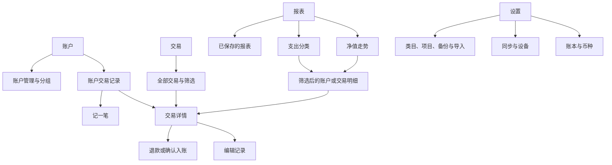

# 厘序产品设计

版本：0.10
日期：2026-10-29
状态：用户对线框整体方向已无更多建议，补充三项实现要求见第 13 节；现有信息足够启动初版实施，无阻塞性产品待确认项。用户随后授权实现，0.4.0 业务前端已交付，见[评审说明](frontend-review-v0.4.0.md)；具体真机、同步和账务验收仍单独记录。
范围：面向使用者的信息架构、页面职责、导航、录入与管理、同步配置、多币种和报表体验。
本轮反馈补充：用户已授权按 [0.4.1 反馈方案](frontend-feedback-v0.4.1.md) 继续实施，页面栈、账户入口、类目管理、组合筛选和报表目录成为当前交互规则；0.5.0 实现与验证见 [交付记录](frontend-review-v0.5.0.md)。正式入口移除示例账本切换。
修订依据：[本轮六项反馈与数据核验](product-feedback-2026-10-28.md)。

配套文档：[业务需求与规则](requirements.md)、[技术设计](technical-design.md)、[实施计划](implementation-plan.md)。本文件回答“用户从哪里进入、看到什么、如何完成任务、如何理解结果”。金额、退款、还款与对账仍遵守业务规则；存储和接口由技术设计承接。

实现参照：[2026-10-29 MoneyWiz 3 iOS 实机调研](research-moneywiz-ios-2026-10-29.md)。已通过用户手机验证补全、拆分、双层饼图及明细核对路径；观察与建议分开记录，不把竞品界面当作其财务算法证据，也不扩大已确定的 MVP 范围。

## 1. 产品定位与本轮设计边界

### 1.1 要解决的问题

厘序是一款本地优先的个人记账应用。用户可以快速记录日常收支，管理不同账户和币种，按自己关心的账户、支出类别和时间查看报表，并选择是否连接自己的同步服务。

设计面向可以分享给朋友使用的通用产品：账户名称、账户分组、收支类目、主币种、时区和同步服务都可配置。正式使用时从空账本开始，不自动放入个人银行账户、固定卡号、演示余额或示例交易。示例环境与真实账本隔离。

首版使用者仍是“单人、多设备”。分享软件意味着朋友可以建立各自的独立账本；多人共同编辑一本账、家庭成员权限、厂商托管云服务不自动进入首版范围。自托管服务可以部署在 NAS 或其他用户控制的服务器上。

### 1.2 已明确的要求

| 主题 | 本轮确定的方向 |
| --- | --- |
| 首页 | 紧凑展示总净值、按组排列的账户及原币余额，提高首屏信息密度 |
| 记账 | 保持账户上下文，描述补全带入最近类目；支持一笔消费拆为多个类目 |
| 入账切换 | 新建默认已入账，点列表图标切换；编辑页不要求选择状态，编辑保留原状态 |
| 低频字段 | 项目、备注等按需展开，不挤占日常录入 |
| 表单草稿 | 不作为 MVP 必需；描述和类目仍然必填，保存后可继续编辑补充 |
| 时间 | 编辑器可选时分秒，普通列表显示到分钟；保留源秒和小数秒，不统一清零 |
| 类目管理 | 设置中可维护收支类目，每个类目可配置自己的图标 |
| 导航 | 支持左侧边缘返回；返回按钮可保持小图标，但要容易点中 |
| 交易管理 | 支持编辑与删除；回收站/恢复不是 MVP 必需，关联退款不强制连带删除 |
| 账户管理 | 支持新增、排序、分组与归档；归档隐藏且禁止新增，允许修正旧记录 |
| 跨币种转账 | 正式能力必须覆盖跨币种转账和还款，可以后续实现 |
| 同步 | 独立可选功能，同源自托管；访问密码登录并记住设备，不绑定 NAS 名称 |
| 币种 | 建账/迁移时选主币，产生金额记录后首版锁定；账户币种独立 |
| 汇率 MVP 范围 | 不接外部报价；手填转账两端金额，并将实际汇率用于对应账户的区间主币折算 |
| 正式统计 | 账户显示余额、净值与收支/分类/项目正式报表只计已入账，未入账单独管理 |
| 报表 | 优先设计净值走势和支出分类；支持对象选择与时间范围 |
| 产品呈现 | 页面按长期使用的正式产品设计，不显示 P0/原型标签或常驻教学说明 |
| 发布 | 继续使用固定安装与访问地址，用户不需要更换端口、添加参数或清数据来获取更新 |

### 1.3 已确认决定与设计默认值

2026-10-28 用户已确认以下六项：

1. 同步采用同源自托管服务，访问密码登录并保持设备会话；一次性配对码后置。
2. 主币种在创建/迁移时选择，默认 CNY；首笔金额记录（含期初余额和未入账记录）保存后，首版锁定。单张报表临时切换显示币种与整本变更主币均后置。
3. 汇率来源与管理能力移出 MVP；跨币种转账手填转出、转入实际金额，系统派生实际汇率并按相邻转入区间折算该外币账户的已入账交易，不联网取行情。A 之前用 A，A–B 之间用 B；不随市场汇率变化。
4. 账户显示余额和正式报表只计已入账；未入账记录不计入合计。
5. 最新转入之后的尾段先使用最近一次有效转入汇率，标明折算暂定；下一次转入后更新这一段。
6. 净值按所选账户的已入账原币余额乘该时点对应区间汇率，再汇总为主币；不采用逐笔流水折算后累计作为净值公式。

其余设计默认值如下；已确认规则及后续迁移/部署输入集中列于第 15 节：

- 首版每个安装环境激活一本账本，优先把一本账的使用和恢复做完整。
- 同源部署是首版交付方式。连接另一个来源的服务时，从目标服务的 PWA 入口进入并完成账本迁移；统一前端任意连接跨域服务不在首版承诺内。
- 报表优先交付净值曲线、对应一级/二级类目的双层饼图、完整筛选与下钻。

## 2. 用户任务与产品原则

| 任务 | 用户希望获得的结果 |
| --- | --- |
| 快速记一笔 | 在常用账户里输入金额和描述，类目尽量自动带出，保存后立即结束或继续 |
| 修正一笔记录 | 找到原记录直接修改，知道相关余额、退款或对账会受到什么影响 |
| 整理账户 | 把常用账户放前面，按自己的习惯分组，不破坏旧交易 |
| 查看财务变化 | 选择账户和时间，看到可解释、可下钻的净值走势 |
| 查看钱花在哪里 | 选择支出类别和时间，查看总支出、退款、净支出及原始明细 |
| 跨设备使用 | 明确连接哪一个服务、哪一本账；设备不可达时仍可记账 |
| 在新设备继续 | 连接既有账本，先核对账本身份和余额，再恢复本机使用 |

原则：高频任务短路径，低频任务有明确归属；尽量通过默认值和历史输入减少操作。首页显示业务信息，开发者信息放到专门入口。错误在发生处反馈，保存成功只表示已真正保存。所有汇总都能解释来源，缺少汇率或存在冲突时给出具体缺口。

## 3. 用户理解的几个概念

| 概念 | 产品中的含义 | 例子 |
| --- | --- | --- |
| 账本 | 一套独立的账户、交易、类目、主币种和报表偏好 | “个人账本” |
| 账户 | 一种币种下的钱或负债 | 人民币储蓄卡、美元信用卡 |
| 账户类型 | 决定业务行为，例如信用卡负债和还款 | 现金、银行、电子钱包、信用卡 |
| 账户分组 | 仅用于整理账户首页，可自行命名和排序 | 日常、储蓄、信用卡、不常用 |
| 收支类目 | 表示一笔收入或支出的用途，可分层 | 餐饮 → 咖啡茶饮 |
| 旅游项目 | 汇集一次旅行中跨类目的费用 | “京都旅行” |
| 主币种 | 本账本报表和成本确认使用的基准币种 | CNY；也可在建账时选其他已支持币种 |
| 同步服务 | 保存跨设备账本副本的服务 | 用户自行部署的服务 |

账户分组可以跨账户类型。把信用卡移到“日常”组，不会把它变成储蓄账户。将消费从“餐饮”改为“购物”，也不会改变它属于哪个账户组。

## 4. 信息架构与页面职责

手机保留四个主入口：**账户、交易、报表、设置**。桌面采用同样的概念，使用侧栏、列表与详情并排提高操作效率。



| 页面 | 主要内容 | 主要操作 |
| --- | --- | --- |
| 账户首页 | 一行总净值、分组、账户名称、原币余额 | 进入账户、快速新增、创建分组、管理账户 |
| 账户交易记录 | 当前余额、按日分组的交易、搜索筛选 | 记一笔、打开详情、账户菜单 |
| 全部交易 | 跨账户交易与组合筛选 | 搜索、筛选、打开详情 |
| 交易详情 | 金额、账户、日期、类目、项目、关联业务 | 编辑、退款、确认入账、删除 |
| 记一笔/编辑 | 高频字段、候选条、折叠选填字段 | 保存、保存后继续、取消 |
| 报表首页 | 两种基础报表入口、常用报表 | 打开、创建、整理已保存报表 |
| 报表详情 | 图表、汇总、筛选、下钻 | 改范围、查看明细、保存配置 |
| 设置 | 账本、币种、同步、管理与数据操作 | 更改配置、导出、恢复 |

首页顶部使用一行总净值，保留更多空间给账户选择；点总净值进入默认净值范围的走势报表。不再放大块月收支摘要或隐藏金额按钮。

## 5. 首次使用与账本设置

### 5.1 新建本机账本

首次进入提供“新建账本”和“连接已有账本”两个入口。

新建流程：填写账本名称 → 选择主币种和业务时区 → 添加第一个账户 → 进入该账户。主币种默认 CNY，时区默认取设备当前时区供确认；默认值仍可修改。更换设备或旅行时不自动改变账本时区和历史业务日期。默认收支类目可使用一套简洁模板，之后可以更名、归档和重新排序。

同步是可跳过的独立步骤。用户可以先完成记账，再到设置启用同步。未启用同步是正常使用模式，不显示连接失败或大量“待同步”告警。

空账户页只提供“添加账户”主操作；空交易页提供“记一笔”。说明按首次需要出现，不在长期使用中重复占据空间。

### 5.2 连接已有账本

输入或确认服务地址 → 输入访问口令 → 展示远端账本预览 → 确认连接 → 准备本机副本 → 进入账户。

预览至少显示账本名称、主币种、账户数量、最近更新时间和若干账户余额，帮助用户确认连接对象。首次准备完成前清楚显示进度；完成后才提示可离线使用。

本机已有其他账本时进入专门的切换流程，不能用远端内容直接覆盖当前数据，见第 9 节。

## 6. 导航、返回与手势

### 6.1 返回规则

- 次级页面左上角保留“返回图标 + 上一级名称”。图标不必变大，可点击区域建议至少 44 × 44 CSS px。
- 支持从屏幕左侧边缘向右滑返回上一层。横向短滑回弹，明确的返回手势完成导航；具体阈值通过真机调整。
- 在 Safari 中与浏览器返回保持一致，在主屏幕独立应用中提供同样的页面层级语义。不能只靠手势完成返回。
- 返回账户列表或交易列表时，恢复之前的滚动位置、搜索词、筛选条件与选中账户。
- 报表下钻后返回，恢复图表、时间范围、选中点和已展开类目。
- 根页面不触发应用内的上一层返回。横向候选条、图表拖动和账户排序有自己的手势区域，避免争抢左侧返回手势。

主入口切换保留各入口上次的浏览位置；再次点击当前入口可回到该入口根页面。表单打开时返回先关闭表单；未保存内容的退出规则见下节。

### 6.2 表单退出：草稿不列入 MVP

不要求自动保存未提交表单、跨次打开恢复草稿或提供草稿列表。保存时描述和类目仍为必填；用户可先完成必要信息，再通过编辑补充项目、备注或更正金额。

没有改动时直接退出；有未保存改动时，建议提供“继续填写 / 放弃本次修改”的离开确认，不自动写成正式交易。已保存的原记录保持不变。该确认的频率和手势配合留待交互 review，不通过增加强制草稿流程解决。

保存失败必须在当前页面保留输入，属于基本错误处理。已经确认保存的记录、待同步操作和对账工作进度也必须保留；这些不属于被移出 MVP 的交易表单草稿。现有原型已经实现的草稿不在本轮直接删除，后续按新范围调整。

### 6.3 应用更新

同一链接和主屏幕图标继续使用。联网打开或恢复前台时检查更新；正在录入时不强制刷新，完成保存或明确放弃输入、退出表单后再应用。更新失败仍可使用上一个完整版本。版本号只放在设置的开发者信息中。

## 7. 账户首页与账户管理

### 7.1 首页布局

```text
账户                         管理    ＋
总净值 CNY                   74,956.50 ›

▾ 日常                       3,900.00 CNY
  微信钱包                     765.40 CNY   ＋
  支付宝                     2,646.60 CNY   ＋
  现金                         488.00 CNY   ＋

▾ 储蓄                      75,091.50 CNY
  日常储蓄卡                 46,891.50 CNY   ＋
  工资卡                    18,200.00 CNY   ＋
  备用金                    10,000.00 CNY   ＋

▾ 信用卡                    −4,005.00 CNY
  日常信用卡                 −2,425.00 CNY   ＋
  旅行信用卡                 −1,580.00 CNY   ＋

▾ 外币账户           −30,000 JPY · 200 USD
  日元信用卡                   −30,000 JPY   ＋
  美元账户                      200.00 USD   ＋
```

以上为合成布局示例；总净值还包含已归档旧交通卡 20 CNY，外币按示例转账区间折算。账户行始终显示账户原币，点整行进入交易记录，行尾“＋”直接使用该账户新增。分组默认展示原币分别合计，不将不同币种金额直接相加。混合币种过多时用“另有 N 种币种”打开完整合计，不无限加高组头。顶部总净值按第 10 节的转账区间规则折为主币；组内合计继续保留原币，不引入市场估值。总净值只计已入账，包含标为“纳入总净值”的归档账户；折算依据缺失时显示可折算小计和缺口入口，不把缺失金额按零算成完整净值。最新尾段暂定的具体依据收在净值详情中。

账户分组可折叠，折叠状态在当前设备保留；账户与分组顺序属于账本设置，可以随账本同步。跨设备时不要求手机与桌面具有相同的滚动位置。

### 7.2 管理模式

首页右上角“＋”提供“添加账户 / 新建分组”。管理分组页也提供新建入口，可新增、重命名和调整分组顺序；创建空组后显示“暂无账户”和“添加账户”，从该组添加时默认选中它。新建分组不依赖先添加账户。

普通模式右上角“＋”负责新增账户/分组，“管理”负责整理已有账户。进入管理后，右上角改为“完成”，隐藏全局加号和账户行的快捷记账加号；不再在底部重复提供“添加账户”，空组的开户提示也仅在普通模式显示。管理状态显示拖动手柄、账户菜单，以及“管理分组”“已归档”入口；分组管理内可创建分组。新增与整理职责分开，不能用多个同义添加按钮填满页面。

实际实现时从操作柄启动拖动，账户行跟随手指移动，原位置保留占位，其他行随落点让位；接近列表边缘时自动滚动，松手落位并保存顺序，取消则恢复原序。拖动过程不误触打开账户、不与左侧返回手势争抢。上移/下移菜单保留为替代操作。线框 v2 的手柄只是位置示意，不作为真实拖动验收。

| 操作 | 行为 |
| --- | --- |
| 新增账户 | 填名称、类型、币种、所在分组、期初日期与余额；信用卡可填额度 |
| 编辑账户 | 更名、图标、分组、“纳入总净值”及其他展示属性 |
| 移动顺序 | 组内拖动；另提供“移到顶部/上移/下移”菜单，方便触控和无障碍操作 |
| 移动到其他组 | 在账户菜单选目标分组；跨组拖动可作为补充方式 |
| 新建/整理分组 | 名称、排序、折叠；删除非空组前先选择账户的去向 |
| 归档账户 | 从日常首页和新增账户选择中隐藏，禁止以该账户新增收支、转账端、退款到账或余额调整；保留交易与报表 |
| 取消归档 | 从“已归档账户”恢复，保留原分组与位置，也可重新选择；之后才允许新增交易 |
| 调整余额 | 从具体账户的二级菜单进入，填写核对后余额、日期和原因 |

已有交易的账户不直接改币种；需要另一种币种时新建账户，按实际资金变动转账。账户类型若会改变负债或记账规则，也需要专门处理，不能通过改名称或分组隐式转换。

### 7.3 已归档账户

归档是账户状态，不需要再建一个“废弃账户”分组来安置历史。入口为“设置 → 账户与分组 → 已归档”，账户页二级菜单可提供同一入口。已归档页按原分组查看余额、历史交易，支持取消归档。

归档后不能新增交易，但允许直接修正旧记录的金额、日期、描述和类目，仍遵守普通记录的对账/成本影响规则。旧交易更正不会自动取消归档。若要新建一笔退款并退到该归档账户，需要先取消归档；选择其他活跃到账账户时，可继续引用归档账户中的原消费。

归档不要求余额归零，不产生清零流水，也不删除历史交易。日常首页的组内展示合计只计算显示中的活跃账户；历史净值和既有报表范围仍保留归档账户，归档本身不改写走势。若原有组内账户均已归档，可从日常首页隐藏整组，但管理入口仍可查看；新建的空分组保持可见，方便继续添加账户。

具有历史交易的账户不提供普通的物理删除入口；未使用的空账户可以删除。多设备迟到记录与归档状态冲突时保留内容待处理，不静默丢掉交易。

### 7.4 “纳入总净值”与报表账户选择的区别

“纳入总净值”定义账本长期的个人资产负债范围，默认开启。首页总净值及新开净值报表的默认范围使用该设置；个人现金、储蓄、钱包、外币资产和信用卡负债都应纳入，负债保留负号参与汇总。

只有在同一本账中跟踪不属于自己的钱时通常需要关闭，例如代家人保管的资金、公司的备用金或仅用于核对的外部账户。关闭不改变账户余额、交易、分类支出报表或历史数据，也不隐藏账户。临时不常用的个人账户应归档，归档本身不改变净值范围。

报表的账户选择器用于本次分析，可以临时包含全局排除的账户，也可只看储蓄；它不反向修改“纳入总净值”。改变全局设置会更新首页及使用默认范围的历史走势；用户明确保存了固定账户集合的常用报表继续使用该集合。账户编辑中将此开关放在次要位置，解释收进“此设置的作用”，不在首页常驻说明。

## 8. 交易记录、录入与编辑

### 8.1 交易列表和详情

列表按业务日期分组，展示描述、金额、类目和必要的状态。默认列表保留已入账和未入账条目，未入账用虚线图标及简短标记区分；可单独筛选待入账。全部交易列表补充账户；账户内列表保留当前账户上下文。搜索支持描述和备注；账户、类型、类目、项目、日期和状态作为筛选。

2026-10-29 反馈确认：组合筛选按[0.4.1 反馈方案](frontend-feedback-v0.4.1.md)补齐；金额范围放在筛选面板底部，按币种比较原币金额，账户内默认该账户币种。类目筛选按拆分命中部分统计，打开仍可查看整笔。条件组内多选取“或”，不同条件组取“且”；已生效条件可移除，返回时保留筛选与位置。此确认是产品规则，尚不表示前端已补齐。

点击左侧类目图标直接切换已入账/未入账，点击其余行区域进入详情。新建默认已入账，表单不提供必填入账开关；编辑只改内容并保留原状态。图标切换后条目留在列表，余额、首页净值和正式报表同步更新，简短反馈当前状态；不会修改消费时间或自动把银行记账日期改为今天。转账两端作为一笔同时切换。已对账或已分配成本的记录先说明影响，按既有重新核验流程处理，不强行一键绕过保护。

银行最终金额变化时先编辑同一笔记录的金额，必要时展开更正银行记账日期，再点列表图标入账；日期沿用已有有效值，未有单独银行日期时默认交易日期。未知金额或日期尚不满足正式入账条件时，就地提示补齐再切换；不以零金额代填。详情也可提供等价的“确认入账”便捷操作。

点交易进入详情。“编辑”是主要操作；退款、确认入账等只在适用的原记录上出现。“删除”使用明确的文字入口并防止误操作。回收站或撤销可以保留为便利能力，但不是 MVP 必须完成的用户流程。

### 8.2 高频录入

顺序建议为：当前账户 → 支出/收入/转账 → 金额 → 描述 → 类目 → 发生时间 → 折叠的旅游项目和备注。

- 从账户进入默认使用该账户；连续保存保持账户，不重复从长列表选择。
- 描述未输入时展示最近 8 个不同描述；输入后匹配包含内容，前缀优先，同一优先级按最近记录排序。
- 手机聚焦描述时，横向候选条贴近键盘上方；不抢占系统拼音候选。桌面放在描述输入框附近，支持方向键和 Enter。
- 选择描述带入最近一次该描述同收支类型的类目；手动选择的类目不因随后修改描述而丢失。
- 类目先展示一级分组，展开后选二级；低频管理入口不混在候选中。
- 时间编辑器可选择年月日时分秒；普通交易列表仍只显示到分钟。新建默认取当前时间，保留秒；调整日期、小时或分钟时不自动清零秒，只有显式修改秒才替换它。导入和无关字段编辑保留已有秒及小数秒。
- 同一账户同一分钟的记录按完整时间排序，显示到分钟不等于存储精度只有分钟。同秒时也要保持稳定次序；本次备份没有同账户同秒冲突，暂不增加单独的手工排序功能。
- 旅游项目和备注默认折叠，编辑已有内容时展开。保存后再记一笔默认不偷偷沿用项目。
- 金额、描述、类目和保存可在软键盘打开时操作；输入区域随可视范围滚动，保存按钮不能被遮挡。

### 8.2.1 一笔消费拆为多个类目

记账的类目行提供“拆分”入口；类目选择器也可进入。普通单类目记账保持原来的短路径。拆分页显示总金额、已分配和差额，每项选择类目并填金额，可添加/移除项；项目和备注在每项内按需展开。示例：超市 126 元，餐饮·生鲜食品 86 元，购物·日用品 40 元。

所有拆分项必须有类目和正金额，并与交易总额按币种精度严格相等后才能完成；有差额时留在拆分页就地提示。改变总金额不静默缩放用户已填拆分。整体项目可作为未单独设置项目的拆分项默认值；多项目时逐项指定。选择描述候选不覆盖已经手动整理的拆分。

详情逐行展示各类目及金额，编辑时保留拆分身份。拆分只是一笔消费的内部归属，账户余额扣一次总额。分类或项目报表只统计命中的拆分金额：仅选生鲜食品统计 86 元；下钻展示所选 86 元及原交易 126 元，点开进入完整原交易；父子类目同时命中不得重复计算。

### 8.3 编辑记录

详情 → 编辑 → 修改字段 → 保存。普通未关联收支允许修改账户、金额、描述、类目、时间、项目和备注。保存后更新原记录，返回原来的列表与位置，不再新增一笔相同交易。

| 记录状态 | 编辑体验 |
| --- | --- |
| 普通收支 | 直接编辑；保存后余额、列表和报表更新一次 |
| 转账/还款 | 打开同一笔转账表单，同时展示两端；不能把一端单独改成独立记录 |
| 待入账消费 | 可补充或更正消费信息；先编辑银行正式金额及必要的银行日期，再从列表图标或详情确认入账；编辑本身保留未入账，仍更新原消费 |
| 有关联退款 | 提示受影响退款并提供关联核对，不用删除顺序限制代替影响说明；缺少历史关联时不猜配对 |
| 已对账 | 改金额、账户或影响余额的日期前，显示受影响的对账批次并要求重新打开核验；改备注或类目不重开余额对账 |
| 成本已分配 | 改本金、还款或成本来源时展示受影响项；无法安全更正则进入专门流程，不能静默改写已确认成本 |
| 同步冲突 | 保留本机已保存内容，展示本机与另一版本的差异；由用户选择结果 |

关联影响预览用业务语言，例如“将影响 2 笔退款”或“需要重新核对 10 月账单”，不显示数据库实体和版本号。确认前展示实际受影响的记录；若专门更正能力尚未交付，就只开放安全字段，并解释下一步入口。

### 8.4 退款、删除与可选回收站

新退款仍优先从原消费发起，自动带出类目、项目与可退额，默认保留明确关联。退款是一笔有自身金额、时间与到账账户的记录；关联用于解释来源、辅助成本和分类处理，不要求退款和原消费共同存亡。

本次备份核验发现 630 条直接退款关联，均能核对至 578 笔原支出，因此导入时应保留这些有证据的关系。对没有可验证关系的其他历史数据，保留退款类型、账户、金额和类目，不凭描述或金额相似度强行配对，也不因为缺关联就拒绝导入。

删除原消费且存在关联退款时，展示“有 N 笔关联退款”，提供“仅删除本笔 / 一并删除关联退款 / 取消”。不强制先删除退款，也不默认连带删除。删除退款时可提示其来源，默认仅删除退款本身。

若后续提供回收站，两种记录都可独立恢复，不要求先恢复原消费；原消费仍被删除时，退款详情保留“原消费已删除”的历史关联。恢复不自动恢复另一端。关联金额出现不一致时列为待核对，不以关联检查为由阻止真实记录恢复，也不静默修改金额。

新建关联退款仍辅助检查可退额。删除/恢复之后若累计关联金额需要重新核验，显示问题并保留记录；涉及成本的未知部分保持待处理，不能用错误成本填平报表。用户层面的回收站不是 MVP 必需；同步层保留删除标记和必要历史仍属于数据一致性保护。

### 8.5 跨币种转账和还款——本轮设计，后续实现

入口仍是“转账”。选定两端账户后分别填写转出、转入实际金额，币种由账户决定；两端金额是跨币种转账的必填项，系统据此显示本笔实际汇率及方向，例如“1 CNY = X JPY”。MVP 不提供报价刷新、汇率来源/API Key 配置或根据参考价自动填写另一端，不要求另填汇率。没有网络也能保存。已知的独立手续费折叠录入，并单独计支出。

转账时间默认两端相同；导入保留源数据两端各自的时间。确有差异时在展开项编辑发送/接收时间，不能因合并成一笔业务而抹平账户流水的时间。

转入信用卡时建议用途为“还款”，允许确认。普通还款不重复计支出；银行一次购汇还款，只记一笔主币账户 → 外币信用卡的真实转账。

外币还款的正常路径只要求两端实际金额及日期。默认覆盖“上次还款之后、截至本次还款之间已入账的消费”，先处理更早尚未偿还的本金。成本分配结果可以展开查看，正常结果不要求逐笔手动勾选；异常时显示“还款已记录，成本待处理”。手动调整分配仍为低优先级。

首个后续界面版本可以先补编辑与账户管理。当前同币种限制属于未完成功能，不能成为正式产品的长期规则。

## 9. 同步与设备：独立产品功能

### 9.1 产品入口与部署方式

设置中提供 **“同步与设备”**，与“账本与币种”“备份与恢复”并列。普通页面使用“同步服务”“已同步”“待同步”，不把 NAS 写成固定产品概念。

PWA 安装地址决定网页来源；同步连接还需要确定服务、账本和访问授权。同一服务同时提供 PWA 和同步接口时，可以自动发现并预填服务地址，但不能仅凭访问网页就自动上传本机账本或认定已经登录。

已确认：首版在一个固定 HTTPS 地址同时提供页面与同步服务。手动配置同源服务路径可以直接使用；输入另一个来源的服务地址时，先检查兼容性并引导进入该服务的 PWA 入口，经过账本保留和切换流程。不能在当前版本画出一个“任意 URL + Token 都能同步”的配置承诺。

朋友可以部署各自的独立服务，也可以从可访问的 HTTPS 应用入口初始化后仅使用本机账本。软件分发应提供部署或安装指引，不把个人家庭网络地址当成所有人的固定入口。本稿不承诺提供官方托管、家庭协作、任意 WebDAV 或第三方网盘直连。

### 9.2 配置页面

| 页面区域 | 内容 |
| --- | --- |
| 当前模式 | 仅本机 / 已连接 / 已暂停 |
| 服务 | 显示名称、服务地址、远端账本名称及身份 |
| 状态 | 最近成功同步时间、待同步笔数、有无冲突或需处理事项 |
| 设备 | 当前设备名称，其他已授权设备及最近活动，可撤销设备授权 |
| 操作 | 立即同步、暂停、重新登录、更换服务、断开连接 |

连接表单首版只出现服务地址和访问密码，不要求用户名。同源地址自动填入，用户仍需明确启用同步。访问口令用于建立设备会话，之后不用每次打开或每笔保存重复输入。设备名默认取可辨认的名称，可修改。

首次部署由服务所有者设置访问密码。已授权设备可在“同步与设备”中查看、改名和撤销；忘记密码通过服务部署管理入口重置并撤销既有会话，不引入邮件找回。密码失效只停止后续同步，已初始化的本机账本继续可用。

这里的口令是服务访问密码，不是长期 Token 文本。管理员令牌不放进安装链接或普通用户分享配置。一次性设备配对码可在后续加入：由已授权设备或服务管理端生成，短期有效且使用后失效。该方式需要单独补充授权设计，不把临时 demo 的静态连接口令当成已经完成的方案。

### 9.3 三条连接路径

| 当前情况 | 产品流程 |
| --- | --- |
| 本机已有账本，服务尚无账本 | 登录 → 确认“将本机账本启用同步” → 预览名称、主币种、账户与记录数量 → 上传初始化 → 核对结果 |
| 新设备，本机无账本，服务已有账本 | 登录 → 预览远端账本 → 下载完整副本 → 核对余额 → 正常使用 |
| 本机和服务都是同一本账 | 识别账本身份 → 续传未同步内容与拉取变化 → 处理冲突 |

本机与服务各有一本不同的账时，进入“选择要使用的账本”。首版不自动合并两本账，也不使用“最新覆盖旧版”。切换前保留原本机账本和未上传记录为可读取、可导出的本机归档；旧版已有的草稿也兼容保留；完成远端核验后再激活目标账本。归档入口放在设置的备份与恢复中。

首版每次只激活一本账。保留切换前的数据是恢复保护，不扩展成同时管理多本账的日常导航。

### 9.4 日常状态与异常

| 状态 | 日常页面表现 | 在同步页能做什么 |
| --- | --- | --- |
| 仅本机 | 正常保存，不显示连接错误 | 随时启用同步 |
| 已同步 | 只在需要查看时显示最近同步时间 | 查看设备与记录 |
| 有待同步内容 | 紧凑状态入口，例如“3 笔待同步” | 查看数量、最长等待时间，立即同步 |
| 服务不可达 | “已存本机”，正常记账；不反复弹错 | 查看服务地址和上次成功时间，重试 |
| 登录失效 | “需要重新连接”，已保存记录保留 | 重新登录后继续上传 |
| 有冲突 | 明确的待处理标记，不阻止无关记录保存 | 并排比较本机与远端，确认处理结果 |
| 服务恢复了旧备份 | 停止自动覆盖，进入恢复核对 | 比较本机较新记录、未上传内容与恢复结果 |

开启、恢复前台和保存后尝试同步；只在前台继续重试。关闭 PWA 后不承诺定时同步。本机保存、跨设备已同步、银行入账、对账和成本确认分别表达。

暂停只停止同步；断开连接结束当前设备连接，保留本机账本，也不删除远端账本。更换服务走“更换地址 → 身份核验 → 选择迁移当前账本或连接已有账本 → 核对”的完整流程，不能把原待上传内容直接发到另一套账本。

设备撤销停止后续访问，不能承诺擦除一台离线设备已有的副本。同步也不等于独立备份；备份位置、最近成功时间与恢复入口在“备份与恢复”单独管理。

## 10. 币种与汇率产品设计

### 10.1 主币种和账户币种

| 设置 | 默认与规则 |
| --- | --- |
| 账本主币种 | 建账或迁移时选择，默认 CNY；可从已支持币种中选择其他币种 |
| 账户币种 | 创建账户时选择，默认主币种；已有交易后不直接改变 |
| 支持目录 | 首批至少 CNY、USD、JPY；使用币种目录及各自金额精度，之后可扩展 |
| 显示 | 账户行用原币金额与币种代码，避免 CNY/JPY 仅凭同一个 ¥ 符号产生歧义 |
| 报表 | 仅统计已入账；外币使用转账区间汇率向主币折算，明细可查看来源转账和适用区间 |

#### 两种外币使用场景

| 场景 | 账户与记录 | 换汇发生在哪里 |
| --- | --- | --- |
| 真正的外币账户 | 账户以 USD/JPY 等外币记账，余额和日常记录使用该账户币种 | 从主币账户转入或还款时，记录两端金额与实际汇率 |
| 银行最终按账户币种结算 | 账户以银行最终结算币种记账；当前 CNY 主币账本示例中，可直接用 CNY 估计金额记未入账消费，商户外币仅为选填信息 | 银行入账时改为实际账户币种金额并标记入账；之后转账和还款使用该账户币种 |

银行产品被称作“多币种信用卡”，不代表账本必须拆出多个余额账户。第二种场景只展示一个结算币种余额，不为临时 JPY/USD 信息创建子账户或额外欠款。若同一卡确有独立外币欠款，则另建对应外币账户，并可放入同一账户组。

第二种场景的最短流程：在主币账户填写描述、类目、估计主币金额，保存后点列表图标标为未入账 → 银行确认后修改同一笔主币金额，必要时更正银行日期，再点图标入账。消费日期与身份保留，不新增第二笔支出。

商户原币和银行中间金额均为可选。新的记录可不填，旧数据缺失时也不补造，不强迫用户为十年历史回忆原币数值。已有原币值可以作为补充保留，但它不是保存、入账、还款或导入成功的前提。暂估主币金额与最终主币金额分别保留更正历史。

已确认：尚未保存任何金额记录时可直接修改主币；首笔金额记录保存后首版锁定，金额记录包括期初余额与未入账记录。迁移前先确认主币，导入后同样锁定。设置中显示当前主币及变更限制；以后通过独立预览与迁移流程支持更换。账户币种和银行结算币种不会随账本主币或报表显示改变。临时把单张报表换成另一种显示币种也后置。

之前需求中的 CNY 成本，作为主币种为人民币的具体业务样例继续有效。通用产品要把报表与成本计价推广为所选主币种；相关技术规则需后续同步修订，本稿不表示现有实现已经完成泛化。

### 10.2 按转账区间折算主币（已确认）

外币账户保留原币账目，报表采用真实主币转入/还款形成的固定汇率，不采用市场报价。用户已明确该规则也用于净值走势，不能因为取消报价接入就将主币折算移出 MVP。

以主币 CNY、账户 JPY 为例，转入 A、B 的实际汇率分别为 `rA = A 的 CNY 本金 / A 的 JPY 本金`、`rB = B 的 CNY 本金 / B 的 JPY 本金`，单位为 CNY/JPY：

| 交易所在区间 | 用于主币折算的汇率 |
| --- | --- |
| 第一次有效转入 A 之前的已入账交易 | A 的实际汇率 rA |
| A 之后、截至 B 的已入账交易 | B 的实际汇率 rB，即 `(A, B]` |
| B 之后、截至 C 的已入账交易 | C 的实际汇率 rC，依此类推 |
| 最新转入 B 之后，下一次转入 C 尚未发生 | 先用 B 的实际汇率 rB，标明折算暂定；C 有效入账后将 `(B, C]` 更新为 rC |

例如合成转账 A 为 500 CNY → 10,000 JPY，B 为 600 CNY → 10,000 JPY：A 之前一笔已入账 1,000 JPY 折算为 50 CNY，A–B 之间一笔已入账 1,000 JPY 折算为 60 CNY。消费仍归属自身消费日期，不能挪到转账日期，转账本金不计作第二次支出。

区间只针对目标外币账户独立确定；一次其他账户的转账不会重写所有 JPY 账户。区间边界使用有效已入账转账在外币账户一端的完整记账时间，沿用已有 `(前次, 本次]` 规则。转账自身的两端本金始终保留真实金额，不用别段汇率改写；可分离手续费独立计费用，不混入本金比值。

普通退款、余额调整不自动成为新的换汇边界。既有退款成本关联和部分/超额还款的真实本金覆盖约束继续保留；区间折算不能凭空改变原币余额、将未偿金额标为已偿，或让成本来源被重复使用。

这里“静态”指结果不随行情变动。新增下一笔真实转入会为上一段提供新依据；编辑或删除已有转账也可能改变相关区间。报表保留来源、计算版本与影响说明，不能继续使用已经失效的来源。尾段先沿用最新有效转入汇率；下一次有效转入后更新刚闭合的尾段，并以新转入汇率作为新的尾段暂定依据。净值使用原币已入账余额乘对应区间汇率；这两项已确认。

#### 尾段更新与净值的合成例子

若 B 为 600 CNY → 10,000 JPY，汇率为 0.06 CNY/JPY。B 之后某时点已入账余额为 4,000 JPY，C 尚未发生时，该账户净值为 240 CNY，并标明按 B 暂定。

后来 C 为 550 CNY → 10,000 JPY，汇率为 0.055 CNY/JPY。该历史时点位于 `(B, C]`，按 C 更新后为 220 CNY；原币余额仍为 4,000 JPY，原交易未被改写。C 之后的新尾段先用 0.055。其他已闭合区间不会仅因新增 C 被改价。

因此新转入会更新上一段的消费折算及历史净值点；这属于真实转账补齐依据，不是行情重估。报表可查看区间来源、暂定状态与更新时间。没有任何有效转入或主币成本来源时，继续显示来源缺失，不按零补齐完整主币净值。

### 10.3 外部汇率来源移出 MVP（已确认）

MVP 不接外部报价，不做提供方选型、API Key、历史市场报价回填、刷新或全局手工参考汇率维护页。设置保留“账本与币种”。这些能力不再列为 MVP 待确认问题。

跨币种转账手填两端实际金额，系统派生本笔实际汇率，并按第 10.2 节用于相关区间的报表折算。此前“本笔汇率不用于其他交易”“无报价就不做主币净值”的限制已由本轮澄清替代。

历史数据可用已验证转账按同一明确规则生成区间折算结果，标明“按转账区间折算”；这是一套可复算的产品计价规则，不等于源软件已经保存逐笔真实成本分配。没有任何可验证来源、间接转入的主币成本未知或缺少开户基准时，保留原币并提示来源缺失，不填零、不捏造行情，也不要求重建十年商户原币。

### 10.4 只计已入账：与折算依据分别处理（已确认）

账户首页、账户内显示余额、净值及收入/支出/分类/项目正式报表都只统计 `posted` 的有效记录。`pending` 不参与账户余额、正式图表或合计，也不提供默认混入暂估金额的报表模式。未入账条目在默认交易列表带标记显示，也可筛选为独立待确认列表；两处均可查看、修改并从图标切换状态。

银行确认时更新同一笔交易的金额、记账日期与状态，入账后才进入余额及正式报表。入账状态决定是否纳入，消费日期决定消费报表所属期间；补确认旧消费会更新其原消费期间，不新增第二笔支出。撤销未入账记录不制造退款。

银行按主币结算的交易，以实际主币入账金额直接统计；商户原币仍可空。外币账户以账户原币入账后即属于已入账，不能因还未还款或缺下一次转入而改称未入账。其主币折算按转账区间处理，最新尾段和来源缺失需要单独说明，不能把两种状态混为一谈。

## 11. 报表：优先完成的核心体验

MVP 报表按第 10 节采用转账区间主币折算，所有正式统计只计已入账。尾段沿用最近有效转入汇率，下次转入后更新；净值按原币已入账余额乘对应区间汇率汇总。外部市场报价继续后置。

### 11.1 报表首页

首屏提供“净值走势”“支出分类”和已保存的常用报表。用户常用的两类报表不藏在报表商城或多层模板选择里。

```text
报表

净值走势                    支出分类

我的报表                            ＋
年度净值       本年 · 全部纳入总净值的账户
日常开销       本月 · 餐饮/出行/购物
旅行费用       自定义期间 · 旅游项目
```

从基础报表进入即可使用默认配置，改变筛选不要求先保存模板。名称、范围和时间只保存用户主动设定的常用报表，避免每次查看自动生成一份副本。

### 11.2 净值走势

| 项目 | 设计 |
| --- | --- |
| 默认时间 | 近 12 个月，按月末查看；可改为其他范围 |
| 对象选择 | 账户多选，按账户分组展示；默认全部“纳入总净值”的账户 |
| 时间选择 | 本月、上月、本年、近 12 个月、自定义开始/结束日期 |
| 粒度 | 日、周、月；按范围建议默认值，用户可修改 |
| 图表 | 折线图；点选或拖动查看时点净值，不要求精确点中极小的点 |
| 汇总 | 期初、期末、净变动及增减方向；百分比只在分母合理时展示 |
| 下钻 | 某个时点 → 当时各账户原币余额和主币估值 → 账户交易与期间变动 |

期初取所选开始时点之前的余额，图中提供范围起点；结束日期在未来时截至当前，并显示实际截止日期。不能用期间第一笔交易之后的余额代替期初。

每个点只包含该时点的已入账账户余额。每个账户的主币值 = 该时点已入账原币余额 × 该时点对应区间汇率；总净值为所选账户主币值之和。主币账户汇率为 1，信用卡负余额直接参与，不能先取绝对值。日、周、月分别取该日、该周末、该月末的余额；当前未结束的一期取当前截止时点并标明截止日期。空白交易日沿用上一个原币余额，折算来源缺失与没有交易是两种不同情况。开账基准之前无法核验的余额不填成零，曲线从具备有效余额基准的时点开始，或明确保留早期缺口。

资产为正、信用卡欠款为负，额度不计入资产。净值不等于现金收入减支出；余额调整、期初资产与真实转账的区间折算都可能影响净值。待入账项目不进入账户显示余额及正式净值。

同币种转账在两端账户都被选中时不改变合计；只选择其中一个账户时会改变所选范围余额。跨币种转账可能影响区间折算及手续费，需要能从来源明细解释，不能统一描述成消费。

仅选部分账户时标题使用“所选账户净值”，同时显示账户数量。归档账户不自动从历史范围移除；选择器把已归档账户放在折叠区，并保留已选状态。

### 11.3 支出分类统计

| 项目 | 设计 |
| --- | --- |
| 默认时间 | 本月 |
| 主要对象 | 支出类目多选；先展示一级类目，展开选择二级 |
| 其他筛选 | 账户、旅游项目、折算状态，收进筛选面板；正式报表固定只计已入账 |
| 汇总 | 总支出、退款、净支出；默认展示净支出 |
| 图表 | 双层饼图（同心层级环图）：内圈一级类目，外圈为对应二级类目，子项扇区严格落在父项的角度范围内；下方保留可核对的金额列表 |
| 层级 | 点内圈选中一级类目并高亮其子项，点外圈查看二级类目的金额/占比与明细入口；点明细入口进入筛选后的交易/拆分明细 |
| 明细 | 显示所选类目对应的金额，同时可以打开整笔原交易 |

子类目多选汇总不得重复计算父类目。一级全选包含其后代；父子同时命中时一笔金额只计算一次。拆分类目按拆分金额进入统计，不能把整笔交易金额分别算给每个类目。下钻按原交易合并相同命中项，展示所选拆分小计与原交易总额的关系，打开原交易后能看到全部拆分。

图表采用筛选后的二级类目净支出。同一父类的内圈扇区等于外圈子项之和，不将父子两层再次相加；父子使用稳定的同色系和文字标识。手机点选展示金额、占比和类目路径，小扇区可从金额列表选择，不依赖悬停或直接点击极细扇区。

跨月退款可能使二级类目净支出为负。饼图只画正净支出部分，负值作为“净退款”列表单列，零值不生成扇区；出现负值时图表标为“正净支出构成”，占比分母明确为正值部分合计，汇总仍显示包含负值的真实支出/退款/净支出。一级扇区在此状态表示其正值子项之和，金额列表保留父类真实净额及负值子项，不能用负额相抵后画出不守恒的父子扇区。全为零或负值时显示“本期无正净支出”及退款明细，不伪造饼图。

收支、分类与项目正式报表固定只计已入账，以消费日期归属期间。待入账不进入图表或合计，待确认记录另处管理；确认入账或后续转账补齐区间依据时，更新原消费期间，保留状态与折算修订信息。

退款按退款发生日计入对应类目的退款额；原消费月份仍保留原支出。显示支出、退款、净支出三者，可以理解跨月退款造成的本月负净支出。转账本金、还款本金和余额调整不进入分类支出，独立手续费作为费用进入。

图表数值与明细金额应能核对。存在折算暂定、来源缺失或本地冲突版本时，在汇总处显示具体状态入口，而不是给每行加一段说明文字；用户展开后能看到缺口及受影响记录。

### 11.4 选择器和时间的统一规则

- “全部”是动态范围：以后新增且符合条件的账户或类目自动纳入。自选具体账户或二级类目时保留固定选择；账户组全选表示选中当前组内账户。选择一级类目表示选择该分类树，新增子类目自动纳入；取消个别子项时保留排除条件。保存配置时明确显示相应范围。
- 账户与类目选择器支持搜索、分组、全选/取消和已选数量。父项操作覆盖子项；个别子项取消时显示部分选中。归档项折叠展示，但不从历史统计的“全部”范围消失；旧数据的“未分类”也可单独查看。
- 选空范围时显示“未选择账户/类目”，不把空选择解释成全部；没有匹配交易与没有选择对象分开表达。
- 时间范围按账本业务时区包含开始日至结束日。快捷项显示实际起止日期，避免“近一年”与某个自然年混淆。
- 净值使用账户已入账变动的记账日期；支出使用消费日期；退款用退款发生日。这些差异在报表详情可以查看，不要求日常用户理解数据库日期字段。
- 同一报表改变账户、类目、期间或粒度后，图表、汇总和明细使用同一组条件。返回下钻前的页面时条件不丢失。

### 11.5 保存常用报表

“保存为常用报表”填写名称，保存类型、对象范围、时间规则、粒度、折算状态和必要的项目筛选；正式统计固定只计已入账。已有常用报表修改后可“更新此报表”或“另存为”。报表可以排序、重命名和删除，删除报表配置不删除交易。

时间保存时明确区分：

- 相对时间：“本月”“本年”“近 12 个月”，下次打开按当时日期滚动。
- 固定期间：“2026-01-01 至 2026-12-31”，下次仍是同一段历史。

常用报表配置属于账本偏好，可跨设备同步；某次临时拖动选中的图表点和页面滚动位置留在当前设备。账户、分组或类目改名后更新显示名称，保留引用关系；归档或删除相关项时，配置可读并提示需要调整。

### 11.6 具体使用场景

| 用户操作 | 应得到的结果 |
| --- | --- |
| 选择储蓄、现金和信用卡，查看 2026 年月度净值 | 曲线按各月末已入账余额估值，信用卡负债参与，额度不参与 |
| 排除一个不关心的账户，再返回账户列表 | 当前报表范围改变；账户本身及其交易没有被删掉 |
| 只看餐饮中的咖啡和三餐，选择上季度 | 父类目不重复累计，汇总可下钻至相应交易或拆分金额 |
| 本月退回上月一笔支出 | 本月退款增加，可能形成负净支出；上月支出仍可查关联退款 |
| 存在缺少转账/期初来源的美元账户 | 原币余额保留；主币折算显示来源缺失，不按零算出完整净值 |
| 外币账户先后发生转入 A、B | A 之前交易按 A，A–B 之间交易按 B；明细可查看来源，不随外部行情变化 |
| 一笔消费仍未入账，之后确认 | 确认前不进入账户显示余额与正式报表，确认后更新同一笔及其消费期间，不双计 |
| 将当前筛选保存为“日常开销 · 本月” | 下个月打开自动滚动到新月份，自选类目仍保留 |

## 12. 设置、偏好和操作反馈

设置按任务组织：

| 分组 | 内容 |
| --- | --- |
| 账本与币种 | 名称、主币种（金额记录后只读）、时区和支持币种；MVP 无参考汇率配置 |
| 同步与设备 | 服务连接、状态、登录、设备授权与切换 |
| 账户与分组 | 新增、编辑、排序、归档；也可从账户首页管理进入 |
| 收支类目 | 分层、新增、更名、排序、归档 |
| 旅游项目 | 新增、编辑、归档和项目报表入口 |
| 备份与恢复 | 完整导出、导入预览、独立备份状态、本机归档账本与恢复 |
| 最近删除（可选） | 若提供回收站，可查看与独立恢复已删除交易；不列为 MVP 必需 |
| 开发者信息 | 构建、兼容版本、缓存和详细诊断，默认关闭 |

账本层设置（账户、分组、类目、主币种、常用报表）随同步共享。设备层设置（键盘焦点、滚动位置、分组折叠、临时筛选）独立保留。设备授权凭证不放进账本导出或可分享的报表配置。

### 12.1 收支类目管理

“设置 → 收支类目”支持新增、更名、调整层级与顺序、归档，以及为每个类目选择图标。收入与支出分别管理，二级类目也有自己的图标。初始模板提供可区分的默认图标；建议同层易于区分，允许用户主动复用，不把图标唯一性变成保存限制。

更名和换图标更新展示，不改变历史金额与关联。调整父类会影响按当前分类树汇总的历史报表，操作前显示影响范围。使用过的类目以归档为主，已有交易仍可查看；不因删除类目把历史交易一起删掉。

正常页面避免常驻教程。需要用户行动时直接给出可执行反馈：例如“新增退款超过当前可退额”“先重新核对 10 月账单”“本机有 3 笔待同步”。保存失败保留输入；页面加载失败提供重试和读取/导出已有内容的可行入口。

## 13. 现有原型、交互线框与后续交付顺序

2026-10-28 已交付账户首页、记账、交易详情和报表的独立可点击低保真线框，见[线框 v2 的范围、路径与检查记录](wireframe-review-v2.md)。v2 补充多类目拆分、列表图标切换入账、新建分组及首页总净值，并明确全局净值范围与临时报表筛选的区别；[v1](wireframe-review-v1.md) 留作对照。仅使用合成数据，未更新运行中的 PWA 或业务前端。

2026-10-29 用户表示整体方向明显改善，暂无更多建议；以下三项直接纳入实现要求，不再为此重做线框：支出分类改为双层饼图；账户排序支持行跟随手指的真实拖动；新增与管理入口按第 7.2 节收敛。当前信息足够启动初版，真实键盘、手势和拖动效果在代码实现及 iPhone review 中验证。该结论不等于已经交付可替换 MoneyWiz 的完整 MVP；具体实施顺序见实施计划。

### 13.1 现状边界

| 已有基础 | 产品设计仍需补齐的部分 |
| --- | --- |
| 紧凑账户列表、账户上下文录入 | 用户可维护的账户、分组和顺序 |
| 描述候选与类目联动 | 真实键盘、返回手势和完整编辑流程 |
| 删除与恢复 | 关联业务的完整编辑影响与历史修订体验 |
| 本机保存与离线入口 | 独立同步配置、身份授权与恢复流程；自动表单草稿移出 MVP |
| 固定币种样例与简单当月分类概览 | 主币种配置、转账区间折算、筛选下钻和常用报表；外部行情估值后置 |

技术 demo 的可靠性验证和当前界面检查继续作为参考，不作为这些产品能力已经完成的证据。本轮交付设计文档与独立交互线框，不继续扩充业务前端。

### 13.2 建议推进顺序

| 顺序 | 交付 | 与既有阶段的关系 |
| --- | --- | --- |
| 先做产品评审 | 确认本文的页面、概念、同步方式、币种规则和两类报表 | 新的设计门槛，先于继续扩展原型 |
| 交互线框与少量关键场景 | 首次使用、账户管理、交易编辑、返回、同步配置、报表筛选与下钻 | 仍为 P0 产品体验评审；页面不代表后端完成 |
| 本地纵向闭环 | 可配置主币与账户、账户整理、类目图标、编辑、秒级时间、导出及导航 | P1；可先以主币同币记账闭环验收 |
| 同步与设备闭环 | 启用同步、新设备、连接异常、冲突、切换与恢复 | P2；独立验证数据保护 |
| 完整多币交易与成本 | 跨币种转账、还款、完整退款、待入账与成本 | P3/P4，保留用户允许后置的实现顺序 |
| MVP 报表 | 仅已入账、转账区间折算、走势、分类筛选、下钻、常用配置和迁移后核对 | P5；尾段及净值公式已确认，外部参考行情后置，仍需真实历史数据核验 |

报表作为核心任务现在就设计清楚，不等到数据层全部完成才决定交互。实现和验收仍按依赖逐步推进，不以一张好看的走势图代替多币种历史完整性。

## 14. 产品评审检查表

| 场景 | 本稿期望的验收表现 |
| --- | --- |
| 新用户 | 自己选择主币种、建立账户；不依赖开发者预置个人数据即可开始记账 |
| 密集账户 | 可以新增、分组、排序与归档；归档不改写历史余额和走势，取消归档前不能新增 |
| 返回 | 左侧边缘返回与按钮语义一致，保留列表位置和筛选；返回时对未保存修改做明确处理；不要求自动草稿恢复 |
| 拆分 | 一笔消费可拆多个类目和项目，合计严格等于总额；筛选只汇总命中部分，下钻可回到完整交易 |
| 入账 | 默认已入账，点列表图标切换；编辑保留状态；转账两端原子切换，正式统计排除未入账 |
| 首页净值 | 一行显示主币总净值；全局范围与临时报表选择独立，归档不自动排除 |
| 编辑 | 修改原记录只更新一次余额和报表，关联退款或对账受到影响时有明确提示，退款不强制连带删除 |
| 同步 | 同源地址自动填入，访问密码登录并保持设备会话；可撤销设备，知道连的是哪一本账 |
| 服务不可达 | 继续保存和查询；恢复连接后继续同步，没有“网络失败所以交易没记上”的误导 |
| 主币与账户币 | 主币可选；外币账户和主币结算账户分开处理；后者不强求商户原币 |
| 时间 | 编辑可选秒，列表显示分钟；导入保留完整时间，同分钟顺序不随机 |
| 类目 | 设置中可新增、更名、排序、归档和选择各自图标，历史关联保留 |
| 净值走势 | 选择账户和期间、查看某个点、进入账户明细，再返回时范围保持 |
| 支出分类 | 选择父/子类目与时间，仅已入账的退款、拆分和区间折算金额能与明细核对 |
| 常用报表 | 保存后再次打开无需重选全部条件，相对时间与固定期间行为可预测 |
| 分享给朋友 | 安装地址和初始配置不包含个人环境信息，朋友可以建立独立账本和连接自己的服务 |

同步认证、主币锁定、外部报价后置、转账区间折算、只计已入账、尾段和净值公式均已确认。四类线框已获整体方向反馈，三项交互细节作为代码实现要求；无须先补一轮线框。实施准备度评估后，用户已授权并交付 0.4.0 前端；验收边界见其评审说明。


## 15. 产品决定核对与后续输入（2026-10-28）

### 15.1 当前 MVP 无阻塞性产品待确认项

已完成对产品设计、需求、技术设计、实施计划及分期提案的交叉检查。此前两项计算边界已确认，不再列为待选择：

| 已确认主题 | 产品规则 |
| --- | --- |
| 同步认证 | 同源自托管，访问密码登录并记住设备，可撤销设备；一次性配对后置 |
| 主币变更 | 建账/迁移时选择，首笔金额记录后锁定，账户币种独立 |
| 汇率来源与范围 | 不接外部报价，转账手填两端真实金额，按每个外币账户转入区间折算 |
| 区间方向 | 首次 A 之前用 A，`(A, B]` 用 B；退款和余额调整不自动形成新边界 |
| 最新尾段 | 先用最近有效转入汇率，标明折算暂定；下一笔转入后更新刚闭合区间及相关历史报表 |
| 净值公式 | 每个账户的已入账原币余额 × 对应区间汇率，再汇总所选账户主币值；主币汇率为 1，负债保留负号 |
| 正式统计 | 只计已入账，未入账不进入账户显示余额与正式报表；折算暂定不等于 pending |
| 归档与退款 | 归档禁止新增但允许改旧账；有明确退款关联时提示，可独立删除 |
| 草稿与必填 | 表单草稿/回收站可后置，描述与类目仍必填 |
| 分期消费口径 | 原消费确认并入账后一次计全额，各期本金不重复计支出，实际费用另计；分期专用能力仍后置 |

未发现需要用户现在新增选择才能启动初版实施的 MVP 产品问题。2026-10-29 已收集线框整体反馈，饼图、真实拖动与入口收敛直接进入实现要求；具体手势阈值、普通文案及默认图标由实现时细化。真机仍需验证键盘、返回和拖动，不能把信息足够误写成这些体验已经通过。后续授权的前端实现已按本设计交付 0.4.0，未将局部交互验证当作完整首版验收。

### 15.2 到相关阶段再确认的迁移与部署输入

| 输入 | 已有边界与建议处理 | 确认时机 |
| --- | --- | --- |
| 历史外币资产成本和迁移期初欠款 | 能验证则保留，未知不捏造、不阻塞原币余额迁移；是否人工补录来源在迁移预览中逐项选择，不强求重建十年历史 | P4/P5，不阻塞当前产品文档 |
| 旧标签如何映射项目 | 迁移预览选择映射到项目或仅保留历史标记；多项目金额不重复累计 | P5 迁移预览 |
| 服务部署与备份环境 | 型号/运行方式、持久卷、稳定域名及独立备份目标；访问密码建立与重置按第 9 节 | P0/P2 环境验收，不混为页面设计选择 |

两类报表的默认期间继续采用第 11 节方案：净值近 12 个月、分类本月，可保存常用配置；未保存离开表单默认确认继续填写或放弃。它们作为线框 review 默认值，不列为当前阻塞决定。报价供应商、配对码、主币变更、显示币种切换和回收站均为后续可选范围。


## 16. 分期付款的表达（后续提案，未纳入 MVP）

详细讨论见[分期付款产品提案](installment-design.md)。建议以原消费、分期计划、实际账单与还款关联表达，不靠复制未来消费模拟。

- 区分“未入账消费”与“已经成立但未出本期账单的分期本金”，防止只计本期而漏掉剩余负债，也不把全部未来账单预先标为已入账。
- 已确认：原消费确认后一次计全额，各期本金仅改变负债归属、实际入账费用另计；未入账消费仍不进入正式报表。该统计口径不再列为待确认。
- 卡内本金与独立分期负债不能重复纳入总净值；各期出账不等于已经还清，提前结清与退款按银行实际结果处理。
- 保留现有消费、转账与费用能力；分期计划页、期次和专用对账仍是后续范围。本次仅补设计，不恢复前端开发。

## 16. 0.5.0 交互规则确认与实现

2026-10-29，用户确认按此前建议继续实现。以下规则补充并细化前文，金额、汇率、入账和历史数据规则不变。

- 账户、交易、报表、设置各自保留页面栈；切换入口不进入另一个入口的返回链。根页返回停止；再次点击当前主入口回该入口根页。
- 从左边缘向右拖动返回，从右边缘向左拖动前进，只处理当前入口的分支。返回后打开其他页面舍弃该分支的前进记录。返回优先关闭选择器、弹窗，再退出页面。
- 拖动期间不卸载编辑页。短滑回弹；超过阈值且有修改，页面回弹后只显示一次“继续填写 / 放弃修改”。取消保留字段与位置；放弃后前进只重新打开已保存版本或空的新建表单，不恢复废弃内容。浏览器内部返回走相同保护，不使用系统 confirm。真正关闭或刷新仍可使用浏览器离页保护。
- 账户管理提供新增账户、新增分组；普通首页只保留管理及记一笔入口。账户可直接拖入其他分组，包括组头、空分组，松手后一次保存归属和顺序。
- 类目常显手柄，点名称/图标编辑，右侧归档；父类拖动包含子类，子类可移入同一收支类型的其他父类，保持最多两层。归档保留历史，恢复子类时恢复其父类的可用状态。
- 交易搜索匹配描述、备注和拆分备注；组合条件按字段间“且”、字段内“或”。类目和项目同时筛选时要求同一拆分项匹配，明细保留整笔并标出匹配部分。账户内固定该账户币种；全账本按选定原币比较金额，跨币种转账按匹配端点的金额、时间显示。
- 报表根页为常用报表和报表类型目录；净值与分类进入独立详情，新增类型以后扩展目录。常用报表保存相对或固定时间、对象范围，可更名、拖动排序及删除配置；不删除交易。

iPhone Safari 原生边缘动画仍须独立真机验收；本机验证和领域测试不代替该门槛。地址、端口及无参数访问方式保持原样。

## 17. 本轮整理与页面预览修订（0.6.0）

- 滑动下层展示实际目标页面的只读视图，保存滚动位置；主入口无后退目标时不滑动，不用额外浏览器历史页当背景。编辑保护规则继续有效。
- 账户/类目管理统一：点名称或条目编辑，右侧紧凑归档，触屏长按手柄拖动；名称保持可复制。拖动时临时关闭选择，结束恢复。
- 分组与上级类目均可不填。未分组账户平常直接展示，管理时显示投放区；独立类目直接选择，有子类才展开。最大两级继续保留，不强制每项有子类。
- 首页管理与记账使用同套图标按钮，保留可访问名称。新增账户/分组仍在管理工具区。

实现、证据和真机边界见 [0.6.0 反馈修复](frontend-review-v0.6.0.md)。
